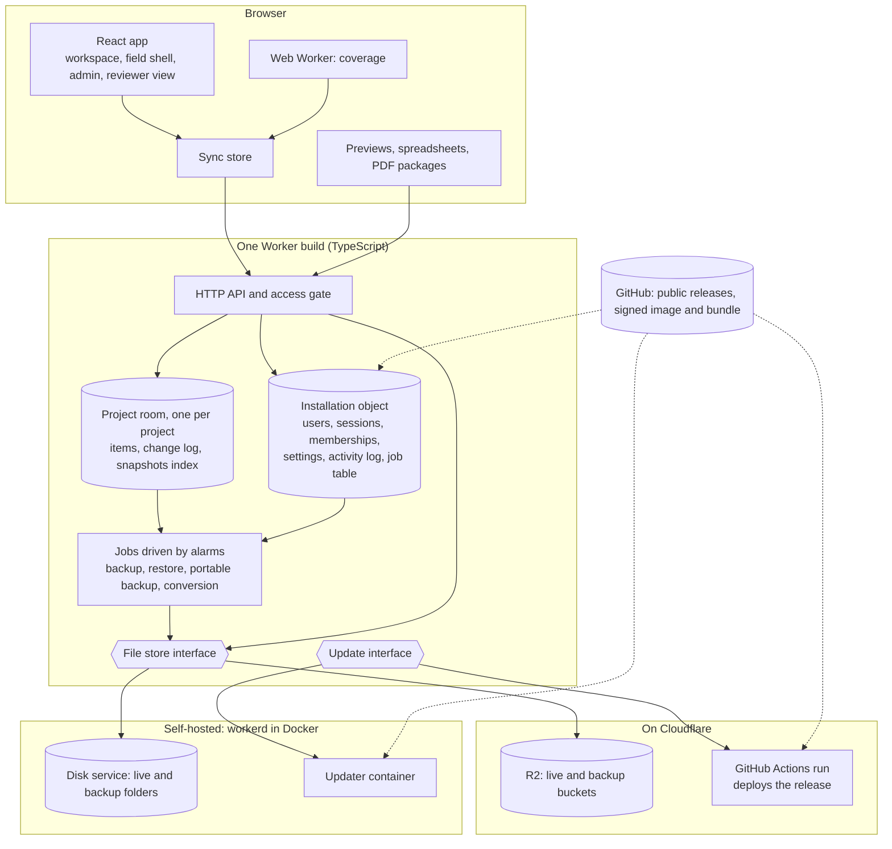

# Site Studio — Architecture

This document decides how Site Studio is built, hosted and updated so that it meets the [PRD](../../prds/prd-PhySecDesign-2026-11-16/prd.md) and the [UX design specification](../../ux/ux-PhySecDesign-2026-11-18/ux-design-specification.md). It changes no requirement.

**What changed from version 2.1.** Six experiments were run early on 2026-11-18 ([record](../../../../experiments/README.md)). Kevin then made three decisions:

1. **One server build for both hosts.** The same Worker runs on Cloudflare and, self-hosted, under Cloudflare's open-source runtime. The separate Node.js server of version 2.1 is dropped.
2. **PDF packages stay generated in the browser**, with smaller pages.
3. **A Cloudflare update is started through a GitHub Actions run**, because it can name the release to install.

Versions 1.0 to 2.1 are in the repository history.

Nothing here has been built. The experiments ran in a cloud container on synthetic data; they show direction and are not acceptance results. Cloudflare limits are from Cloudflare's documentation as read on 2026-11-18 and are collected in [cloudflare-limits.md](cloudflare-limits.md).

## 1. Summary

Site Studio is one server build and one browser application. An organisation runs it in one of two ways, with the same features either way (NFR-7).

| | On Cloudflare | Self-hosted |
| --- | --- | --- |
| Runs as | A Cloudflare Worker | The same Worker, run by Cloudflare's open-source runtime (`workerd`) in a Docker container on Linux |
| Project records | One Durable Object with SQLite per project | The same; the runtime keeps one SQLite file per project on local disk |
| Users, sessions, settings, activity log | One Durable Object for the installation | The same |
| Scheduled and long jobs | Durable Object alarms | The same |
| Files | An R2 bucket | A folder on disk, through the runtime's disk service |
| Updates | A GitHub Actions run deploys the chosen release | An updater container installs the chosen release |

Only two things differ between hosts: where files are stored, and how an update is installed.

- People sign in with email and password. Role and project membership are checked on the server for every request, including every file.
- Clients can still review one fixed revision through a reviewer link, without an account.
- Browsers save with small, retry-safe operations and learn of other people's changes by polling.
- Coverage analysis, previews, spreadsheet parsing and PDF packages stay in the browser.
- Each release is published on GitHub, signed, with notes. An administrator installs it with one action, after an automatic backup and with a return to the earlier version if anything fails.

## 2. What drives the design

| Driver | Source | Consequence |
| --- | --- | --- |
| Self-hosted or on Cloudflare, same product | FR-66, NFR-7 | One server build. Host differences confined to file storage and update installation. |
| Accounts, roles and membership, enforced on the server | FR-67–69, NFR-5 | An installation-wide store for users and sessions; an access check in front of every project request and file. |
| Administrator controls and an activity log | FR-70, FR-71 | An administration interface over the installation store. |
| Update from the interface, safely | FR-72, NFR-8 | Signed public releases, ordered data conversions, backup first, health check, automatic return. |
| One shared durable project; saves within 2 s; others see them within 5 s | FR-2, FR-21, NFR-2 | A store per project with a change feed. |
| Per-item conflicts; connected changes validated together | FR-42 | Versioned items; multi-item operations applied as one unit by a single writer per project. |
| Fixed issued designs, closeouts and exact package files | FR-26, FR-32, FR-34, NFR-1, NFR-6 | Immutable snapshots and files named by content hash. |
| Files to 100 MiB, 8 GiB per project, 10 GiB portable backup | Acceptance table | Uploads in parts; streaming downloads. |
| Daily backups, seven generations, restore within 60 minutes | FR-34 | A scheduled job, separate backup storage, scripted isolated restore. |
| Honest analysis within 10 s at 1 m sampling or finer | FR-13, NFR-4 | Analysis off the main thread, keyed to its inputs, limited by time and never by silently coarser sampling. |

## 3. Starting point

**Prototype today.** React 19 and Vite 6 in plain JavaScript, Leaflet, pdf.js; about 8,800 lines in `site-studio/src`; 137 test cases on Node's test runner (not rerun for this document). The project is one JSON document in the browser. A review service with revocable links exists only inside the development server. The build is already packaged as a Cloudflare-style Worker serving static assets. The repository carries an MIT licence.

**What carries over.** The interface, the map, every calculation module, PDF import and export, and the link and version ideas from the review service.

**What is replaced.** Browser storage as the place of record, the single-document model, the dialogs, and the development-only review service.

**One defect found by experiment R2.** The prototype's combined coverage has a fixed work budget that coarsens sampling to 6 to 12 m on the acceptance workload. See AD-9.

## 4. Architecture at a glance



## 5. Hosting and portability

### AD-1 — Two hosts, one build (confirmed; revised by K16)

- **Cloudflare.** One Worker serves the built application and the API. The Workers Paid plan is required (K1).
- **Self-hosted.** A Docker image holds Cloudflare's open-source runtime, `workerd`, at a pinned version, together with the same Worker bundle and a configuration file. It is started with Docker Compose alongside an updater container (AD-21) and a web server that provides HTTPS. HTTPS is required (FR-66); the bundled web server is optional for an operator who already has one. A virtual machine and a physical server are the same case: a Linux machine with Docker.

The image needs a glibc-based base (the runtime has no Alpine build) and is built for x64 and arm64.

Why the open-source runtime: experiment R8 ran a Worker with a SQLite-backed Durable Object under it on a plain Linux server, with no experimental flag. Every acknowledged write survived 45 forced kills, timers survived restarts, and Cloudflare documents the runtime's use "as an application server, to self-host applications designed for Cloudflare Workers". Its warning that it is "not a hardened sandbox" concerns running untrusted code; Site Studio runs only its own.

Not supported at first: running without Docker, Windows Server as the host, and Kubernetes.

### AD-16 — What may differ between hosts (confirmed; revised by K16)

The server is written once. Host-specific code is confined to two small interfaces.

| Interface | Purpose | Cloudflare | Self-hosted |
| --- | --- | --- | --- |
| File store | Put in parts, get as a stream with ranges, check existence, list, delete; one live area and one backup area | Two R2 buckets | Two folders through the runtime's disk service |
| Update | Report how updates are installed here; start one; report progress | A GitHub Actions run | The updater container |

Everything else is identical on both hosts because it uses only what ran in experiment R8 without the experimental flag:

- **Durable Objects with SQLite** for all records.
- **Durable Object alarms** for the daily backup and for long jobs.
- **Web-standard interfaces** (Request, Response, streams, Web Crypto).

Deliberately not used, because the open-source runtime offers them only behind an experimental flag or not at all: D1, Workflows, Queues, scheduled triggers and KV. Version 2.1's use of D1 and Workflows is withdrawn.

Rules that keep it so:

- The server reaches storage only through the project room, the installation object and the file-store interface. No route touches a platform binding directly.
- The self-hosted file store adds what R2 provides and the disk service does not: a stored hash and size per file, kept in the project room's records.
- The test suite runs in Cloudflare's runtime. A smoke suite runs the built bundle under the self-hosted configuration in continuous integration: start, set up, sign in, save, upload a file, restart, read back.
- The portable backup (AD-14) is the same format on both hosts.

**Fallback kept open.** If the open-source runtime proves unsuitable, a Node.js server remains possible: the project room and installation object are reached through narrow classes whose storage calls are plain SQL against SQLite. Nothing is built for this unless needed.

## 6. Records, files and saving

### AD-2 — One store per project, with a single writer (confirmed)

Each project has its own Durable Object, the project room, with its own SQLite database. It handles one write at a time, which makes "check the versions and dependencies, then apply every change or none" (FR-42) ordinary code in one place. Experiment R8 confirmed that a change that throws part-way rolls back completely.

### AD-3 — Files are named by their content hash and never overwritten (confirmed)

Originals, previews, spreadsheet sources, snapshots, PDF volumes and manifests are stored under their SHA-256 hash within the project's area. A photo is Saved only when the file is complete and the entry that references it is committed (FR-31).

### AD-4 — Large files upload in parts (confirmed)

Uploads above a few megabytes go in equal parts of 8 MiB through the API, which checks access on each part. Experiment R6 confirmed that R2 requires parts of at least 5 MiB, all the same size except the last, and aborts an unfinished upload after 7 days. The browser therefore cuts parts at fixed boundaries, and an interrupted upload can resume from the last accepted part. The self-hosted file store follows the same rules so that the browser behaves identically.

### AD-5 — Saves are small operations with an identifier; conflicts are per item (confirmed)

An operation carries a client-chosen identifier, the session, and changes that each name an item and the version they were based on. The project room returns the stored result for a repeated identifier, checks access and versions, checks the rules that span items, then applies everything and appends one change-log entry. Evidence is append-only and never conflicts. The actor recorded is the signed-in account and its name at that time (FR-69), supplied by the access gate and never by the browser.

### AD-6 — Polling for other people's changes (confirmed)

Every 3 seconds while the page is visible, and on regaining focus. Incoming changes never overwrite a field being edited. A live push channel can be added later.

### AD-7 — The change log is history, feed and basis for undo (confirmed)

Undo is a new operation restoring the before-values of one of the same user's own operations in the same session, accepted only if nothing affected has changed since.

### AD-8 — Fixed records are immutable snapshots (confirmed)

Named revisions, the surveyed baseline, issued designs and closeout records are written from one consistent point and referenced by hash. The current issued design is a versioned pointer.

### AD-9 — Analysis runs in the browser, off the main thread, limited by time (confirmed; revised)

Results carry a fingerprint of their inputs; a mismatch shows Updating. The last final summary per floor is saved with its fingerprint.

Experiment R2 found that the prototype's fixed work budget coarsens sampling to 6 to 12 m on the acceptance workload, which does not meet NFR-4, and that with the budget lifted the same workload finishes in under half a second at 0.5 m sampling. Therefore:

- The fixed work budget and cell cap are removed. Sampling is 1 m or finer, as NFR-4 requires.
- The calculation runs in a Web Worker and is cancelled and restarted when inputs change.
- If a calculation would exceed its time allowance, the result is shown as incomplete with the reason. Sampling is never coarsened silently to finish in time.

### AD-10 — File processing stays in the browser (confirmed)

PDF opening and passwords, photo previews and spreadsheet parsing happen in the browser. The server enforces limits and types regardless.

### AD-11 — PDF packages are generated in the desktop browser and retained on the server (confirmed; revised by K17)

A package is generated from a fixed snapshot, uploaded volume by volume, and registered only when every file is present and verified.

Experiment R1 measured the prototype's exporter at full size: about 13 seconds for 250 pages, but 570 to 710 KiB a page, so a 250-page volume would be about 160 MiB against the 100 MiB limit, and an edition of about 480 MiB would take about 13 minutes to upload at the reference uplink. Therefore:

- **Smaller pages.** Schedule and table pages are written as real text, not as images of text, which also makes them searchable. Plan and photo pages stay as images at a JPEG quality chosen by a legibility check on paper; quality 0.85 brings a 250-page volume to about 106 MiB, and 0.75 to about 83 MiB.
- **Volumes split at whichever limit comes first**, 250 pages or 100 MiB, as the PRD allows.
- **Upload is visible and resumable.** Each volume uploads in parts (AD-4) with progress, survives a dropped connection, and is released from memory before the next is generated. The interface says plainly that the tab must stay open and shows time remaining.
- Generation time and upload time are reported separately, as the PRD measures them.

Set aside: rendering on the server. Cloudflare's browser service can produce PDFs (confirmed in R6), but a self-hosted installation would need its own headless browser. It remains the fallback if upload times prove unacceptable in use.

## 7. Accounts and access

### AD-12 — Sessions for people who sign in; link tokens for reviewers (confirmed)

**Signing in.**

- An account has an email address, a name, a password hash, an installation role and an active flag (FR-67, FR-68).
- Passwords are hashed with PBKDF2-SHA256 through Web Crypto, with a per-user salt and an iteration count that follows current published guidance. Experiment R8 measured 600,000 iterations at about 75 ms under the open-source runtime. Hashes carry their parameters so they can be strengthened later. Whether Cloudflare's hosted platform accepts that count within its limits is still to be confirmed (experiment R9).
- A successful sign-in creates a session: a long random token held in a cookie that scripts cannot read, sent only over HTTPS and only to this site. Only a hash of the token is stored. Sessions end after the period without use the administrator sets, on sign-out, on "sign out everywhere", on password change and on deactivation.
- Requests that change anything must come from the application's own origin and carry a header the application adds.
- Failed sign-ins are slowed per account and per address, and the reply never reveals whether an email exists.
- Two-step verification uses time-based codes from an authenticator app, with single-use recovery codes stored as hashes.
- Invitations and password resets are single-use, expiring tokens, delivered by email when email is configured and always available for an administrator to copy.

**Checking access.** Every request passes one gate before it reaches a project room or a file:

1. Identify the caller: a session, a reviewer link token, or neither.
2. For a session: ask the installation object for the account, confirm it is active, and find its role and its membership of the project named in the request.
3. Decide: an administrator may do anything; an Editor may read and change their project, including archiving it and downloading its portable backup; a Viewer may read, search, download existing packages and files and export schedules and estimates, and may create nothing, with one exception: a Viewer who is the approval assignee for a fixed revision may comment and decide on it (FR-23, FR-68); a reviewer link may read one fixed revision, comment and decide (FR-24). Only administrators change a project's members.
4. Pass the decision and the actor to the project room. The project room trusts only this gate.

Removing a member or deactivating an account takes effect on the next request (FR-68).

**Rules the store enforces.** The last administrator cannot be demoted or deactivated. When two-step verification is required, an account without it can do nothing but set it up. An approval assignment whose account is deactivated or removed is marked unavailable. Ending a session never discards input pending in an open page.

**Reviewer links** are long random tokens sent as a header, stored as a hash, scoped to one fixed revision and revocable. An index of active links in the installation object lets an administrator list and revoke them (FR-70).

**First administrator.** An installation with no users accepts one set-up request that creates the first administrator, protected by a one-time set-up code shown in the server output or the deployment output.

### AD-17 — The installation object (confirmed; revised by K16)

One Durable Object per installation, addressed by a fixed name, holds: users, password and recovery-code hashes, two-step secrets, sessions, invitations and resets, the project catalogue and memberships, the reviewer-link index, settings, the backup catalogue, the job table and the activity log (FR-71). It replaces the D1 database of version 2.1.

- Secrets entered in settings, such as an email service key, a map key or the GitHub token used for Cloudflare updates, are encrypted with a key supplied to the installation at deployment and are shown only masked.
- The activity log is append-only and is kept for the life of the installation; administrators can filter and export it. Entries never contain a password, token or code.
- Every request consults this one object. Experiment R8 measured about 1,800 small operations a second on a single object, far above the acceptance profile of one or two users. The gate may hold a session's lookup for a few seconds to reduce load; a removal or deactivation must still take effect within that time.

### AD-18 — Email is optional (confirmed; narrowed)

The server has an email interface with two implementations: none, and an HTTP email service. With none, every invitation and reset is a link the administrator copies. No feature requires email.

SMTP, which self-hosting organisations often prefer, depends on the runtime's outbound socket interface and has not been tried. It is experiment R13 and is not promised until it passes.

## 8. Backups and moving projects

### AD-13 — Daily backups to separate storage; scripted, isolated restore (confirmed; revised)

- **Schedule.** The installation object sets a daily alarm. On each alarm it starts one backup job per project and one for its own data. A job runs in resumable steps, each a short alarm-driven piece of work recorded in the job table, so it survives a restart and stays within processing limits.
- **Content.** Each project room exports its records at one consistent point; files not already in the backup area are copied; a manifest lists every record file and file hash. Backups are made through the server, never by copying database files from disk while it runs.
- **Retention.** Seven successful generations are kept, plus one before any update or data conversion. A file leaves the backup area only when no retained generation lists it.
- **Independence.** On Cloudflare the backup area is a second bucket in the same account (K5). Self-hosted, it must be a different disk or machine from the live data; the installer asks for it and the interface warns when it is the same disk.
- **Restoring one project** builds a separate copy, verifies it, and switches only on a deliberate administrator action. It cancels that project's reviewer links and ends no sessions.
- **Recovering an installation** returns accounts, roles and memberships to the recovery point, ends every session and cancels every reviewer link. Administrators are shown the recovery point and asked to review users and members changed since.

### AD-14 — The portable backup is one ZIP format on both hosts (confirmed)

It holds one project's records, snapshots, files and packages, a manifest, and the version of the data format. It holds no accounts, sessions or links; actors' names travel as text. It is built as a job in resumable steps and downloaded afterwards. Import creates a new project in the receiving installation, where an administrator sets its members. An installation refuses a backup made by a newer version than itself.

Because it is made of the application's own records and not of database files, the portable backup is also the way out if the open-source runtime's storage format ever changes incompatibly (AD-20).

## 9. Releases and updates

### AD-19 — One public repository; signed releases built by GitHub Actions (confirmed; revised)

- The source is published in the GitHub repository under its MIT licence. Kevin makes the repository public when the first release is ready (K15).
- A version tag starts a workflow that runs the test suite, builds the one Worker bundle, builds the Docker image from that bundle and a pinned version of the open-source runtime, runs the self-hosted smoke suite against the image, signs both, and publishes a GitHub Release with notes.
- The image is published to GitHub's container registry. Signing is keyless and tied to this repository's release workflow (K14).
- Each release states the data-format version it needs, the runtime version it pins, and whether it changes a Durable Object class (AD-21).

### AD-20 — Data conversions are ordered and forward-only; the runtime version is pinned (confirmed; extended)

- The project room and the installation object each record their data-format version.
- The server carries every conversion since the first release, so an installation can go from any earlier released version to the latest in one update (FR-72).
- Conversions run per project inside a transaction, after the pre-update backup. The server refuses to start against data newer than itself (NFR-8). Going back means restoring the pre-update backup with the earlier version.
- **Schema changes happen inside SQLite, through conversions. Durable Object classes are fixed from the first release**: one class for project rooms and one for the installation object. Experiment R10 found that Cloudflare blocks rollback across a release that adds, renames or removes a class. Holding the classes fixed keeps rollback available.
- **The open-source runtime's on-disk storage format is labelled experimental.** Each release therefore pins the runtime version, and the release workflow starts the new image against a data folder written by the previous release and checks that it reads and converts correctly (experiment R14). A runtime upgrade that fails that check is not released. The portable backup remains a format-independent way out.

### AD-21 — How the Update control works on each host (confirmed; revised by K18)

**Checking for a version.** At least once every 24 hours while running, and when an administrator asks, the server reads the public release list from GitHub. The request contains nothing about the installation. It can be turned off (FR-72).

**The steps, on both hosts** (FR-72): verify the release's signature; warn signed-in users; stop accepting changes of every kind; take a complete backup; install the new version and convert data; check that the sign-in page is served, a project opens and a test save is acknowledged. A failure before installation stops and resumes normal work. A failure after it returns to the earlier version and the backed-up data, and the failed attempt is then recorded. If the return itself cannot be completed, the installation says so and shows manual steps; it never reports success.

**Self-hosted.** A separate updater container does the installing, because the application cannot safely replace itself while running. It is the only part with permission to start and stop containers. The application asks it, over a private connection protected by a shared secret, to install a named version. The updater accepts only versions from the configured repository, verifies the image signature, swaps the image, calls the health check, and on failure restores the backup and starts the earlier image. The same steps can be run from a command line on the server.

**On Cloudflare.** Each organisation deploys from its own copy of the repository, which contains an update workflow. The Update control starts a run of that workflow through GitHub's interface, naming the release to install. Experiment R10 chose this over a Cloudflare deploy hook, which cannot name a version.

- The administrator stores a GitHub token for that repository in settings (AD-17). GitHub documents the classic `repo` scope for this call; whether a narrower fine-grained permission suffices is still to be confirmed.
- The workflow verifies the release's signature, deploys it, waits for the health check, and on failure redeploys the previous version with Cloudflare's rollback command; the earlier version then restores the pre-update backup and records the failure.
- Cloudflare's rollback does not undo data changes and is blocked across a Durable Object class change. The first is why the application restores the backup itself. The second is why AD-20 fixes the classes. A release that must change a class is exceptional: it is marked in its release notes, the Update control says before starting that an automatic return is not available for it, and it is installed by the documented manual procedure.
- Without the token set up, Update shows the exact steps to run the workflow by hand, including the backup and the way back.

## 10. Code structure

```
site-studio/
  src/              React application (JavaScript, existing)
    areas/          one folder per area, the field shell, the reviewer view
    admin/          sign-in, set-up, account, administrator screens
    sync/           sync store, operation queue, polling, upload in parts
    analysis/       Web Worker wrapper around the calculation modules
  shared/           record shapes, validation, state model, roles (TypeScript)
  server/           the one Worker build (TypeScript)
    api/            routes and the access gate
    auth/           accounts, sessions, two-step verification, invitations
    project-room/   the project Durable Object: operations, change log, snapshots
    installation/   the installation Durable Object: users, settings, activity log, job table
    jobs/           backup, restore, portable backup, conversions, driven by alarms
    files/          the file-store interface with its R2 and disk implementations
    update/         the update interface with its two implementations; version check
  deploy/
    cloudflare/     wrangler.jsonc, the update workflow, install guide
    selfhost/       runtime configuration, Dockerfile, docker-compose.yml, install guide
  updater/          the updater container
  tests/            existing tests (Node's test runner)
  server-tests/     server tests in Cloudflare's runtime, and the self-hosted smoke suite
.github/workflows/  test, release
```

Rules for implementers:

- Identifiers are random and never reused or derived from names. Labels such as C-04 are data.
- Every write goes through an operation or an entry. No route edits a record in place without a base version.
- A domain rule is written once, in `shared/`, and called from both sides.
- Times are stored as UTC and shown in local time. Lengths are stored in metres with their basis; money as integer minor units with a currency. Unknown is an explicit value.
- Nothing in file storage is overwritten. No secret enters records or logs.
- The actor of any action comes from the access gate, never from the request body.
- A route that is not explicitly marked as public, reviewer-link or signed-in is refused.
- Only `server/files/` and `server/update/` contain host-specific code. No platform feature outside the list in AD-16 is used.
- No Durable Object class is added, renamed or removed after the first release without Kevin's decision.
- Every new table or record shape comes with its conversion step and a test that converts data from the previous release.

Language and tests (K6): existing application code stays in JavaScript; `shared/`, `server/` and `updater/` are TypeScript. Server tests use Vitest with `@cloudflare/vitest-plugin`, the current name of Cloudflare's test integration, which experiment R7 showed working with the prototype's versions.

## 11. How the quality requirements are met

| Requirement | Approach | Still to prove |
| --- | --- | --- |
| Save within 2 s; seen elsewhere within 5 s | One request to the project room; 3-second polling. | Measure on both hosts. |
| Open within 10 s; switch plan within 5 s | Summaries first, then one floor; previews; routes loaded on demand. | Measure with the large fixture. |
| Analysis within 10 s at 1 m or finer | AD-9. R2 measured under 0.5 s at 0.5 m in a container. | Reference laptop; real geometry; accuracy against a reference. |
| Zero loss of acknowledged saves | The runtime syncs to disk before replying; R8 saw no loss in 45 forced kills. | Power loss, as opposed to process kill (R12). |
| Recovery point 24 h; restore within 60 min | AD-13. | R3, on both hosts. |
| Access enforced on the server | The access gate (AD-12); no file without a check. | Tests for non-members, Viewers, deactivated accounts, ended sessions, revoked and out-of-scope links. |
| Same product on either host | One build (AD-16). Full acceptance on Cloudflare first; self-hosting is not called supported until the same run passes there. | SM-6. |
| Safe updates | AD-20, AD-21. | R11, R14. |
| Fixed records never change | Hash-named files; no update path. | Hash tests after later edits. |

## 12. Risks and experiments

### Run on 2026-11-18

The record and the code are in [experiments/README.md](../../../../experiments/README.md).

| # | Question | Result | Effect on this document |
| --- | --- | --- | --- |
| R1 | Full-size package in the browser within 5 minutes? | Generation about 13 s per 250 pages. Pages are large; upload is the slow part. | AD-11 revised (K17). |
| R2 | 60 cameras and all zones in 10 s at 1 m or finer? | Under 0.5 s at 0.5 m once the prototype's fixed budget is lifted. As shipped, sampling falls to 6 to 12 m. | AD-9 revised. |
| R6 | R2 part size; PDF printing in Cloudflare's browser service. | Both confirmed. | AD-4 states the equal-size rule. |
| R7 | Cloudflare's Vite plugin and test integration with the prototype's versions? | Works. The test package was renamed. | Section 10 names the new package. |
| R8 | Can Cloudflare's open-source runtime host the same build? | Yes for Durable Objects, alarms and files on disk. No built-in R2. Storage format labelled experimental. | AD-1, AD-16, AD-17 revised (K16). |
| R10 | Best trigger for a Cloudflare deployment; going back. | Deploy hooks cannot name a version. Rollback is blocked across a class change and never undoes data. | AD-20, AD-21 revised (K18). |

### Still to run, each with the first story that depends on it

| # | Risk | Experiment | Fallback |
| --- | --- | --- | --- |
| R3 | Restoring 8 GiB within 60 minutes. | Time a full-size restore on each host. | Restore by reference first, copy in the background. |
| R4 | Large photo uploads on phones over poor connections. | Test on a real iPhone and Android phone, throttled. | Smaller parts; resume; warn before very large files. |
| R5 | Building and validating a 10 GiB ZIP in alarm-driven steps. | Build, validate and restore one on each host. | Numbered parts with a manifest. |
| R9 | Does Cloudflare's hosted platform accept the chosen password-hashing cost? | Time PBKDF2 at the chosen count on a deployed Worker. | Lower the count within current guidance, or Argon2id in WebAssembly. |
| R11 | An update that fails half-way must return cleanly on both hosts. | Break an update at each step on a test server and a test Cloudflare account. Confirm Cloudflare's rollback command behaves as documented. | Block the release of the Update control until it does. |
| R12 | Durability and locking of the runtime's SQLite files on real server disks, including power loss. | Test on a typical virtual-machine disk and a network disk; document unsupported storage. | Require local disk for records. |
| R13 | SMTP through the runtime's outbound sockets. | Send a message through a test SMTP server on both hosts. | HTTP email services only. |
| R14 | The runtime's on-disk storage format across a runtime upgrade. | Start a newer runtime against data written by an older one; repeat in every release. | Hold the runtime version; move data by portable backup. |
| R15 | The legibility of smaller package pages. | Print plan and photo pages at JPEG quality 0.94, 0.85 and 0.75; have a person compare them. | Keep higher quality and accept more volumes. |
| R16 | GitHub token permission for starting an update run. | Try a fine-grained token with only the Actions permission. | Document the classic `repo` scope. |

## 13. Confirmed decisions

All confirmed by Kevin on 2026-11-18.

| # | Decision |
| --- | --- |
| K1 | Workers Paid plan on Cloudflare. |
| K2 | One store per project with a single writer. |
| K3 | PDF packages generated in the desktop browser. Refined by K17. |
| K5 | Cloudflare backups in a second bucket in the same account. |
| K6 | Existing application code stays in JavaScript; new server and shared code is TypeScript, tested with Vitest in Cloudflare's runtime. |
| K7 | Keep the static Sites package for now. |
| K8 | Polling for other people's changes. |
| K9 | Self-hosting supported as Docker on Linux. Refined by K16: the container runs Cloudflare's open-source runtime. |
| K10 | Cloudflare first, with the server portable from the first day. Under K16 this means the self-hosted smoke suite runs from the first story. |
| K11 | The updater container may start and stop containers, with a command-line alternative. |
| K12 | A Cloudflare update is deployed by the organisation's own workflow, with manual steps as the fallback. Refined by K18. |
| K13 | Email is optional, with copyable invitation and reset links. |
| K14 | Images in GitHub's container registry, signed without a stored key. |
| K15 | The repository becomes public when the first release is ready. |
| K16 | **One server build for both hosts**, run self-hosted by Cloudflare's open-source runtime. The Node.js server is dropped. The runtime version is pinned per release and each release is tested against the previous release's data. |
| K17 | **Packages stay generated in the browser**, with schedule pages as real text and a lower image quality chosen by a legibility check. |
| K18 | **A Cloudflare update is started by a GitHub Actions run** that names the release, using a GitHub token the administrator stores. |

K4, the permanent administrator key of version 1.0, was replaced in version 2.0 by administrator accounts and a one-time set-up code.

Three consequences of K16 to K18 that were not put to Kevin separately and follow from them:

- The installation's data moves from a D1 database to a Durable Object, and jobs move from Workflows and scheduled triggers to alarms, so that nothing depends on a feature the open-source runtime marks experimental.
- Durable Object classes are fixed from the first release, so that Cloudflare's rollback stays available.
- SMTP is not promised until experiment R13 passes.

## 14. Suggested build order

Input to the epics.

1. **Foundation.** Repository layout; the Worker with a project room and the installation object; local development through Cloudflare's Vite plugin; the self-hosted configuration and its smoke suite from the first story.
2. **Accounts and access.** Set-up, sign-in, sessions, roles, membership, the access gate, the activity log, the first administrator screens. Run R9.
3. **The shared project.** Operations, change log and polling; the sync store; the existing design tool saving to the server; the coverage fix of AD-9.
4. **Files and fixed records.** Uploads in parts, snapshots, issuing, packages with smaller pages. Run R15.
5. **Field work**, then **existing sites and return visits**, then **extended modelling**.
6. **Recovery.** Backups of projects and the installation, restore, portable backup. Run R3 and R5.
7. **Self-hosting.** The Docker image, Compose file and install guide. Run R12 and R13.
8. **Releases and updates.** Release workflow, signing, version check, conversions, the updater, the Cloudflare update workflow. Run R11, R14 and R16. Then the cross-host acceptance of SM-6.

## 15. Not decided here

- Exact tables, request formats and error codes.
- Password length, lock-out thresholds and default session length. These follow current published guidance at implementation time and are recorded then.
- Single sign-on, which the PRD leaves for later. The access gate is the one place it would attach.
- Monitoring beyond built-in logs, the activity log and visible backup and update status.
- Support arrangements, security disclosure process and release cadence for organisations that host the software.
