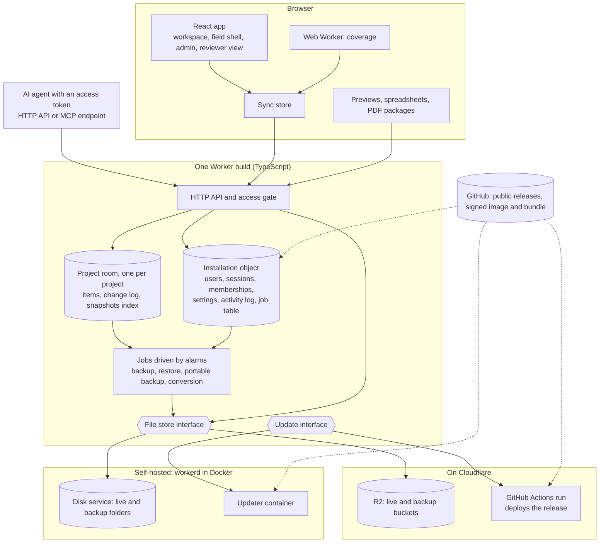

# Site Studio — Architecture

This document decides how Site Studio is built, hosted and updated so that it meets the [PRD](../../prds/prd-PhySecDesign-2026-11-16/prd.md) and the [UX design specification](../../ux/ux-PhySecDesign-2026-11-18/ux-design-specification.md). It changes no requirement.

**What changed from version 2.1.** Six experiments were run early on 2026-11-18 ([record](../../../../experiments/README.md)). Kevin then made three decisions:

1. **One server build for both hosts.** The same Worker runs on Cloudflare and, self-hosted, under Cloudflare's open-source runtime. The separate Node.js server of version 2.1 is dropped.
2. **PDF packages stay generated in the browser**, with smaller pages.
3. **A Cloudflare update is started through a GitHub Actions run**, because it can name the release to install.

Versions 1.0 to 2.1 are in the repository history.

**Version 3.1 (2026-11-19).** PRD amendment 1.3 lets AI agents act for a person. AD-22 adds access tokens, route classes, one declared API and an MCP endpoint; AD-5, AD-9, AD-10, AD-12, AD-16 and AD-17 gain a sentence each, and experiments R17 and R18 are added. Kevin approved the change through the [sprint change proposal](../../sprint-change-proposal-2026-11-19.md) (K23).

Nothing here has been built. The experiments ran in a cloud container on synthetic data; they show direction and are not acceptance results. Cloudflare limits are from Cloudflare's documentation as read on 2026-11-18 and are collected in [cloudflare-limits.md](cloudflare-limits.md).

## 1. Summary

Site Studio is one server build and one browser application. An organisation runs it in one of two ways, with the same features either way (NFR-7).

| | On Cloudflare | Self-hosted |
| --- | --- | --- |
| Runs as | A Cloudflare Worker | The same Worker, run by Cloudflare's open-source runtime (`workerd`) in a Docker container on Linux |
| Project records | One Durable Object with SQLite per project | The same; the runtime keeps one SQLite file per project on local disk |
| Users, sessions, settings, activity log | One Durable Object for the installation | The same |
| Scheduled and long jobs | Durable Object alarms | The same |
| Files | An R2 bucket | A folder on disk, through the runtime's disk service |
| Updates | A GitHub Actions run deploys the chosen release | An updater container installs the chosen release |

Only two things in the application differ between hosts: where files are stored, and how an update is installed. The deployment packaging around it also differs (AD-16).

- People sign in with email and password. Role and project membership are checked on the server for every request, including every file.
- Clients can still review one fixed revision through a reviewer link, without an account.
- Browsers save with small, retry-safe operations and learn of other people's changes by polling.
- Coverage analysis, previews, spreadsheet parsing and PDF packages stay in the browser.
- Each release is published on GitHub, signed, with notes. An administrator installs it with one action, after an automatic backup and with a return to the earlier version if anything fails.

## 2. What drives the design

| Driver | Source | Consequence |
| --- | --- | --- |
| Self-hosted or on Cloudflare, same product | FR-66, NFR-7 | One server build. Host differences confined to file storage, update installation and the deployment packaging outside the build. |
| Accounts, roles and membership, enforced on the server | FR-67–69, NFR-5 | An installation-wide store for users and sessions; an access check in front of every project request and file. |
| Administrator controls and an activity log | FR-70, FR-71 | An administration interface over the installation store. |
| Update from the interface, safely | FR-72, NFR-8 | Signed public releases, ordered data conversions, backup first, health check, automatic return. |
| One shared durable project; saves within 2 s; others see them within 5 s | FR-2, FR-21, NFR-2 | A store per project with a change feed. |
| Per-item conflicts; connected changes validated together | FR-42 | Versioned items; multi-item operations applied as one unit by a single writer per project. |
| Fixed issued designs, closeouts and exact package files | FR-26, FR-32, FR-34, NFR-1, NFR-6 | Immutable snapshots and files named by content hash. |
| Files to 100 MiB, 8 GiB per project, 10 GiB portable backup | Acceptance table | Uploads in parts; streaming downloads. |
| Daily backups, seven generations, restore within 60 minutes | FR-34 | A scheduled job, separate backup storage, scripted isolated restore. |
| Honest analysis within 10 s at 1 m sampling or finer | FR-13, NFR-4 | Analysis off the main thread, keyed to its inputs, limited by time and never by silently coarser sampling. |

## 3. Starting point

**Prototype today.** React 19 and Vite 6 in plain JavaScript, Leaflet, pdf.js; about 8,800 lines in `site-studio/src`; 137 test cases on Node's test runner (not rerun for this document). The project is one JSON document in the browser. A review service with revocable links exists only inside the development server. The build is already packaged as a Cloudflare-style Worker serving static assets. The repository carries an MIT licence.

**What carries over.** The interface, the map, every calculation module, PDF import and export, and the link and version ideas from the review service.

**What is replaced.** Browser storage as the place of record, the single-document model, the dialogs, and the development-only review service.

**One defect found by experiment R2.** The prototype's combined coverage has a fixed work budget that coarsens sampling to 6 to 12 m on the acceptance workload. See AD-9.

## 4. Architecture at a glance



## 5. Hosting and portability

### AD-1 — Two hosts, one build (confirmed; revised by K16)

- **Cloudflare.** One Worker serves the built application and the API. The Workers Paid plan is required (K1).
- **Self-hosted.** A Docker image holds Cloudflare's open-source runtime, `workerd`, at a pinned version, together with the same Worker bundle and a configuration file. It is started with Docker Compose alongside an updater container (AD-21) and a web server that provides HTTPS. HTTPS is required (FR-66); the bundled web server is optional for an operator who already has one. A virtual machine and a physical server are the same case: a Linux machine with Docker.

The image needs a glibc-based base (the runtime has no Alpine build) and is built for x64 and arm64.

Why the open-source runtime: experiment R8 ran a Worker with a SQLite-backed Durable Object under it on a plain Linux server, with no experimental flag. Every acknowledged write survived 45 forced kills, timers survived restarts, and Cloudflare documents the runtime's use "as an application server, to self-host applications designed for Cloudflare Workers". Its warning that it is "not a hardened sandbox" concerns running untrusted code; Site Studio runs only its own.

Not supported at first: running without Docker, Windows Server as the host, and Kubernetes.

### AD-16 — What may differ between hosts (confirmed; revised by K16)

The server is written once. Host-specific code is confined to two small interfaces. Deployment packaging is outside the application build and also differs by host: self-hosted adds the Compose file, the bundled web server with its certificate handling and HTTP-to-HTTPS redirect, and an application port that is not published; on Cloudflare the platform provides these. This difference is stated in the installation instructions, as NFR-7 requires, and is not a difference in the product.

| Interface | Purpose | Cloudflare | Self-hosted |
| --- | --- | --- | --- |
| File store | Put in parts, get as a stream with ranges, check existence, list, delete; one live area and one backup area | Two R2 buckets | Two folders through the runtime's disk service |
| Update | Report how updates are installed here; start one; report progress | A GitHub Actions run | The updater container |

Everything else is identical on both hosts because it uses only what ran in experiment R8 without the experimental flag:

- **Durable Objects with SQLite** for all records.
- **Durable Object alarms** for the daily backup and for long jobs.
- **Web-standard interfaces** (Request, Response, streams, Web Crypto).

Deliberately not used, because the open-source runtime offers them only behind an experimental flag or not at all: D1, Workflows, Queues, scheduled triggers and KV. Version 2.1's use of D1 and Workflows is withdrawn.

Rules that keep it so:

- The server reaches storage only through the project room, the installation object and the file-store interface. No route touches a platform binding directly.
- The self-hosted file store adds what R2 provides and the disk service does not: a stored hash and size per file, kept in the project room's records.
- The test suite runs in Cloudflare's runtime. A smoke suite runs the built bundle under the self-hosted configuration in continuous integration: start, set up, sign in, save, upload a file, restart, read back.
- The portable backup (AD-14) is the same format on both hosts.
- The agent interface (AD-22) uses only what is listed here and calls no service outside the installation.

**Fallback kept open.** If the open-source runtime proves unsuitable, a Node.js server remains possible: the project room and installation object are reached through narrow classes whose storage calls are plain SQL against SQLite. Nothing is built for this unless needed.

## 6. Records, files and saving

### AD-2 — One store per project, with a single writer (confirmed)

Each project has its own Durable Object, the project room, with its own SQLite database. It handles one write at a time, which makes "check the versions and dependencies, then apply every change or none" (FR-42) ordinary code in one place. Experiment R8 confirmed that a change that throws part-way rolls back completely.

### AD-3 — Files are named by their content hash and never overwritten (confirmed)

Originals, previews, spreadsheet sources, snapshots, PDF volumes and manifests are stored under their SHA-256 hash within the project's area. A photo is Saved only when the file is complete and the entry that references it is committed (FR-31).

### AD-4 — Large files upload in parts (confirmed)

Uploads above a few megabytes go in equal parts of 8 MiB through the API, which checks access on each part. Experiment R6 confirmed that R2 requires parts of at least 5 MiB, all the same size except the last, and aborts an unfinished upload after 7 days. The browser therefore cuts parts at fixed boundaries, and an interrupted upload can resume from the last accepted part. The self-hosted file store follows the same rules so that the browser behaves identically.

### AD-5 — Saves are small operations with an identifier; conflicts are per item (confirmed)

An operation carries a client-chosen identifier, the session, and changes that each name an item and the version they were based on. The project room returns the stored result for a repeated identifier, checks access and versions, checks the rules that span items, then applies everything and appends one change-log entry. Evidence is append-only and never conflicts. The actor recorded is the signed-in account and its name at that time (FR-69), supplied by the access gate and never by the browser, with `via` naming the access token when an agent acted (FR-74, AD-22).

### AD-6 — Polling for other people's changes (confirmed)

Every 3 seconds while the page is visible, and on regaining focus. Incoming changes never overwrite a field being edited. A live push channel can be added later.

### AD-7 — The change log is history, feed and basis for undo (confirmed)

Undo is a new operation restoring the before-values of one of the same user's own operations in the same session, accepted only if nothing affected has changed since.

### AD-8 — Fixed records are immutable snapshots (confirmed)

Named revisions, the surveyed baseline, issued designs and closeout records are written from one consistent point and referenced by hash. The current issued design is a versioned pointer.

### AD-9 — Analysis runs in the browser, off the main thread, limited by time (confirmed; revised)

Results carry a fingerprint of their inputs; a mismatch shows Updating. The last final summary per floor is saved with its fingerprint.

Experiment R2 found that the prototype's fixed work budget coarsens sampling to 6 to 12 m on the acceptance workload, which does not meet NFR-4, and that with the budget lifted the same workload finishes in under half a second at 0.5 m sampling. Therefore:

- The fixed work budget and cell cap are removed. Sampling is 1 m or finer, as NFR-4 requires.
- The calculation runs in a Web Worker and is cancelled and restarted when inputs change.
- If a calculation would exceed its time allowance, the result is shown as incomplete with the reason. Sampling is never coarsened silently to finish in time.
- The calculation itself lives in `shared/`, so that the server can run the same code for an agent (AD-22, FR-77).

### AD-10 — File processing stays in the browser (confirmed)

PDF opening and passwords, photo previews and spreadsheet parsing happen in the browser. The server enforces limits and types regardless. The spreadsheet parser lives in `shared/` so that the server can also run it for an agent's import (AD-22, FR-77).

### AD-11 — PDF packages are generated in the desktop browser and retained on the server (confirmed; revised by K17)

A package is generated from a fixed snapshot, uploaded volume by volume, and registered only when every file is present and verified.

Experiment R1 measured the prototype's exporter at full size: about 13 seconds for 250 pages, but 570 to 710 KiB a page, so a 250-page volume would be about 160 MiB against the 100 MiB limit, and an edition of about 480 MiB would take about 13 minutes to upload at the reference uplink. Therefore:

- **Smaller pages.** Schedule and table pages are written as real text, not as images of text, which also makes them searchable. Plan and photo pages stay as images at a JPEG quality chosen by a legibility check on paper; quality 0.85 brings a 250-page volume to about 106 MiB, and 0.75 to about 83 MiB.
- **Volumes split at whichever limit comes first**, 250 pages or 100 MiB, as the PRD allows.
- **Upload is visible and resumable.** Each volume uploads in parts (AD-4) with progress, survives a dropped connection, and is released from memory before the next is generated. The interface says plainly that the tab must stay open and shows time remaining.
- Generation time and upload time are reported separately, as the PRD measures them.

Set aside: rendering on the server. Cloudflare's browser service can produce PDFs (confirmed in R6), but a self-hosted installation would need its own headless browser. It remains the fallback if upload times prove unacceptable in use.

## 7. Accounts and access

### AD-12 — Sessions for people who sign in; link tokens for reviewers (confirmed)

**Signing in.**

- An account has an email address, a name, a password hash, an installation role and an active flag (FR-67, FR-68).
- Passwords are hashed with scrypt (N = 131,072, r = 8, p = 1, a 32-byte result) and a per-user salt, through the runtime's Node.js-compatible crypto interface (K19). This replaces PBKDF2-SHA256 at 600,000 iterations: experiment R9, run on 2026-11-19, found that Cloudflare refuses any PBKDF2 call above 100,000 iterations, which is below current published guidance. The scrypt setting is one that guidance lists, worked on both hosts with identical results, and added about 0.36 s to a request on Cloudflare and about 0.43 s under the open-source runtime. Hashes carry their parameters so they can be strengthened later.
- A successful sign-in creates a session: a long random token held in a cookie that scripts cannot read, sent only over HTTPS and only to this site. Only a hash of the token is stored. Sessions end after the period without use the administrator sets, on sign-out, on "sign out everywhere", on password change and on deactivation.
- Requests that change anything with a session cookie must come from the application's own origin and carry a header the application adds. Requests with an access token are exempt, because a browser never sends one by itself (AD-22).
- Failed sign-ins are slowed per account and per address, and the reply never reveals whether an email exists.
- Two-step verification uses time-based codes from an authenticator app, with single-use recovery codes stored as hashes.
- Invitations and password resets are single-use, expiring tokens, delivered by email when email is configured and always available for an administrator to copy.

**Checking access.** Every request passes one gate before it reaches a project room or a file:

1. Identify the caller: a session, a reviewer link token, an access token sent as a bearer header (AD-22), or neither.
2. For a session: ask the installation object for the account, confirm it is active, and find its role and its membership of the project named in the request.
3. Decide: an administrator may do anything; an Editor may read and change their project, including archiving it and downloading its portable backup; a Viewer may read, search, download existing packages and files and export schedules and estimates, and may create nothing, with one exception: a Viewer who is the approval assignee for a fixed revision may comment and decide on it (FR-23, FR-68); a reviewer link may read one fixed revision, comment and decide (FR-24). Only administrators change a project's members.
4. Pass the decision and the actor to the project room. The project room trusts only this gate.

Removing a member or deactivating an account takes effect on the next request (FR-68).

**Rules the store enforces.** The last administrator cannot be demoted or deactivated. When two-step verification is required, an account without it can do nothing but set it up. An approval assignment whose account is deactivated or removed is marked unavailable. Ending a session never discards input pending in an open page.

**Reviewer links** are long random tokens sent as a header, stored as a hash, scoped to one fixed revision and revocable. An index of active links in the installation object lets an administrator list and revoke them (FR-70).

**First administrator.** An installation with no users accepts one set-up request that creates the first administrator, protected by a one-time set-up code shown in the server output or the deployment output.

### AD-17 — The installation object (confirmed; revised by K16)

One Durable Object per installation, addressed by a fixed name, holds: users, password and recovery-code hashes, two-step secrets, sessions, invitations and resets, the project catalogue and memberships, the reviewer-link index, access tokens and the agent-access setting (AD-22), settings, the backup catalogue, the job table and the activity log (FR-71). It replaces the D1 database of version 2.1.

- Secrets entered in settings, such as an email service key, a map key or the GitHub token used for Cloudflare updates, are encrypted with a key supplied to the installation at deployment and are shown only masked.
- The activity log is append-only and is kept for the life of the installation; administrators can filter and export it. Entries never contain a password, token or code.
- Every request consults this one object. Experiment R8 measured about 1,800 small operations a second on a single object, far above the acceptance profile of one or two users. The gate may hold a session's lookup briefly to reduce load, but a held lookup is discarded the moment membership, role, account state or the session changes, so a removal or deactivation takes effect on that person's next request, as FR-68 requires.

### AD-18 — Email is optional (confirmed; narrowed)

The server has an email interface with two implementations: none, and an HTTP email service. With none, every invitation and reset is a link the administrator copies. No feature requires email.

SMTP, which self-hosting organisations often prefer, depends on the runtime's outbound socket interface. Experiment R13 was run on 2026-11-19: a message was delivered on a server, and from Cloudflare encrypted connections reached the point of signing in. A complete delivery from Cloudflare has not been shown.

### AD-22 — Agent access: tokens, one declared API and an MCP endpoint (K23, approved 2026-11-19)

PRD amendment 1.3 (FR-73 to FR-77) lets AI agents act for a person. The design keeps one code path: the browser app and agents use the same API, behind the same gate.

- **Routes declared once.** Every route is under `/api/v1/` and declares, in `shared/`, a schema for its input and its reply, and its class (below). A request that does not match is refused with the field named, and every refusal carries a reason code as well as its wording. The API description (`/api/v1/openapi.json`) and the MCP tool list are generated from these declarations, and a contract test in continuous integration checks the published description against the server.
- **Route classes.** Each route has exactly one class:
  - public;
  - reviewer link;
  - read;
  - draft change;
  - person only: the actions FR-75 reserves for people;
  - administrator only;
  - update secret.

  The gate decides from the class and the caller kind. A route that declares no class is refused.
- **Access tokens.**
  - **Format and storage.** A token is a long random value with the prefix `ssat_`, sent as `Authorization: Bearer`. The installation object stores its hash with its owner, name, kind (read-only, or read-and-draft), optional project list, expiry and last use.
  - **What a token may do.** A token never exceeds its owner's current role and membership, which the gate looks up on every request as for a session. A read-only token may use read routes only. A read-and-draft token may also use draft-change routes. Person-only and administrator-only routes are refused to every token with the reason "needs a person" or "administrators only".
  - **Lifetime.** 90 days by default and at most 1 year, which an administrator may lower.
  - **Rate limit.** Each token is limited in request rate, counted in the installation object.
  - **Installation switch.** Agent access is off in a new installation until an administrator turns it on, and turning it off refuses every token.
- **The origin rule.** The rule that a change must come from the app's own origin and carry the app's header applies to cookie sessions only. A browser never sends a bearer header by itself, so the rule is not needed for tokens.
- **The actor.** The actor of an action is the account, its name at that time, and `via`: empty for a person, the token's identifier and name for an agent (AD-5).
- **MCP endpoint.**
  - **Transport.** `/mcp` speaks MCP's Streamable HTTP transport without server-held session state, on the same Worker. Each tool call is one or more ordinary API calls made with the caller's token.
  - **Tools.** The tools are generated from the route declarations, and person-only and administrator-only routes are left out.
  - **Text from outside.** Text that came from reviewer links or imported files is returned inside a field marked as entered text, so that an agent can treat it as data.
- **During an update.** An agent receives HTTP 503 with a retry time instead of the browser's "updating, try again shortly" (AD-20).
- **Calculations for agents (FR-77).** The coverage calculation and the spreadsheet parser live in `shared/` and run unchanged on the server when an agent asks; the browser path of AD-9 and AD-10 is unchanged. If experiment R17 shows a calculation can exceed the per-request processing limit at acceptance size, it runs as a resumable job (the AD-13 pattern) and the agent fetches its result. PDF packages stay generated in a browser (AD-11).
- **Both hosts and private networks.** The agent interface uses only what AD-16 lists:
  - plain requests and replies on the same Worker;
  - no Agents SDK, no hosted OAuth provider and no new binding;
  - no call to any service outside the installation.

  It therefore works identically on Cloudflare and under the open-source runtime, including on a server reachable only inside a private network. There, agents run inside the network. The installation instructions show how to make an agent's machine trust a certificate from a private authority. Cloud-hosted AI services cannot reach such a server, which is a property of the network.
- **External tickets (PRD amendment 1.4, FR-78).** The server never fetches an external ticket's link. Links are stored and returned as data and are accepted only with the `http` or `https` scheme, so recording them needs no outbound connection on either host.
- **Refinements from the review of Epic 11 (2026-11-19, applied on Kevin's instruction):**
  - **Tokens.** A token is stored as the SHA-256 of the whole token, found by that hash and compared in constant time; password hashing is not used, because a token carries at least 256 random bits. It is accepted only in the `Authorization` header, and a token-shaped value in a query string is refused and never logged. An administrator's token reaches only projects the administrator is a member of; "all of my projects" means current membership, checked on each request. Recovering the whole installation revokes every token.
  - **Route classes and tokens.** A public route ignores a token; reviewer-link and update-secret routes refuse one. Creating a project and downloading a portable backup are person only.
  - **Rate limits.** Per token, per owner across their tokens, per address for refused tokens, and per address for the public description and the OAuth routes. Calls made inside a tool call count. Over the limit: HTTP 429 with `Retry-After`.
  - **Writes by agents.** Every draft change from a token carries an AD-5 operation identifier, held per token. A conflict returns the item's current version and value and overwrites nothing. A tool that changes anything is one operation, and its owner can undo it as one action. An agent's change to a verified device clears its verified state.
  - **Entered text.** The route declarations have an entered-text field type (text, source, reference), used from story 1.1 on for every reply field holding text from outside the members, so that marking it never changes `/api/v1/` after release. A refusal never repeats an entered value.
  - **The MCP endpoint.** Tool calls run the route handlers in the same process through the gate, never by a request to the server's own address. POST only, JSON replies, no session identifier, the protocol revisions named in the instructions, 405 for GET and DELETE, 403 for a foreign `Origin`, 401 with `WWW-Authenticate` without a token. Tool names are generated within MCP clients' limits, and the tool list follows the token's kind and the owner's role.
  - **CORS.** Token requests are answered to any origin without credentials; cookie requests to the app's own origin only.
  - **Versioning.** Continuous integration compares the description with the last published release's, so a removed or renamed field, a narrowed type or a new required input fails the build.
  - **Jobs for agents.** A job re-checks its token, the switch and the owner's access at each step and when its result is fetched, stops when its target is gone, and restarts when the code version changes.
- **Optional OAuth (decided later in Epic 11).** For MCP connectors that require OAuth sign-in, the installation can act as its own authorisation server, issuing tokens of the same kinds after the person signs in. It serves the protected-resource and authorisation-server metadata, requires PKCE with S256 and exact redirect matching, binds each token to its connector, never lets a refresh grant outlast the token, and shows the redirect host on the consent page. It is optional and built last.

## 8. Backups and moving projects

### AD-13 — Daily backups to separate storage; scripted, isolated restore (confirmed; revised)

- **Schedule.** The installation object sets a daily alarm. On each alarm it starts one backup job per project and one for its own data. A job runs in resumable steps, each a short alarm-driven piece of work recorded in the job table, so it survives a restart and stays within processing limits.
- **Content.** Each project room exports its records at one consistent point; files not already in the backup area are copied; a manifest lists every record file and file hash. Backups are made through the server, never by copying database files from disk while it runs.
- **Retention.** Seven successful generations are kept, plus one before any update or data conversion. A file leaves the backup area only when no retained generation lists it.
- **Independence.** On Cloudflare the backup area is a second bucket in the same account (K5). Self-hosted, it must be a different disk or machine from the live data; the installer asks for it and the interface warns when it is the same disk.
- **Restoring one project** builds a separate copy, verifies it, and switches only on a deliberate administrator action. It cancels that project's reviewer links and ends no sessions.
- **Recovering an installation** returns accounts, roles and memberships to the recovery point, ends every session and cancels every reviewer link. Administrators are shown the recovery point and asked to review users and members changed since.

### AD-14 — The portable backup is one ZIP format on both hosts (confirmed)

It holds one project's records, snapshots, files and packages, a manifest, and the version of the data format. It holds no accounts, sessions or links; actors' names travel as text. It is built as a job in resumable steps and downloaded afterwards. Import creates a new project in the receiving installation, where an administrator sets its members. An installation refuses a backup made by a newer version than itself.

Because it is made of the application's own records and not of database files, the portable backup is also the way out for projects if the open-source runtime's storage format ever changes incompatibly (AD-20). Accounts, settings and the activity log are not in it; they leave the same way through the installation backup of AD-13, which is also made of records and not of database files.

## 9. Releases and updates

### AD-19 — One public repository; signed releases built by GitHub Actions (confirmed; revised)

- The source is published in the GitHub repository under its MIT licence. Kevin makes the repository public when the first release is ready (K15).
- A version tag starts a workflow that runs the test suite, builds the one Worker bundle, builds the Docker image from that bundle and a pinned version of the open-source runtime, runs the self-hosted smoke suite against the image, signs both, and publishes a GitHub Release with notes.
- The image is published to GitHub's container registry. Signing is keyless and tied to this repository's release workflow (K14).
- Each release states the data-format version it needs, the runtime version it pins, and whether it changes a Durable Object class (AD-21).

### AD-20 — Data conversions are ordered and forward-only; each object converts and returns its own data; the runtime version is pinned (confirmed; revised by K20)

This decision was rewritten on 2026-11-19 after the first part of experiment R11, and Kevin confirmed it as K20 on 2026-11-19 together with seven fixes, which are written into the text below and listed at the end of this decision. The earlier text treated "the new version starting" as one moment. On Cloudflare it is not: the entry code changes within about half a second of a deployment, but a Durable Object that is in use keeps running the previous version's code, by default for up to five minutes, while calls already reach it through the new entry code. Cloudflare documents this (code updates are deferred by default since 30 October 2026) and R11 observed it. The design below does not depend on when an object changes version.

**What stays as it was**

- The project room and the installation object each record their data-format version.
- The server carries every conversion since the first release, so an installation can go from any earlier released version to the latest in one update (FR-72).
- A conversion runs only after the complete pre-update backup. Going back always means restoring the pre-update backup under the earlier version.
- An object that finds its data in a newer format than its code understands, with no update in progress, refuses to open it and says why (NFR-8).
- An object that finds its data in an older format than its code, with no update in progress, also refuses to open it and says that the update was not completed. Conversion happens only under an update record (below), never because an object started on newer code.

**One version acts at a time**

- Every release has a version, and every call carries the caller's version: the entry code attaches it to each call to an object, and objects attach it to calls between objects.
- An object that receives a call from a different version refuses the call and stops itself, so that it starts again on whatever code is now deployed. The caller tries once more, and otherwise answers "updating, try again shortly".
- An object stops itself at most once in a short interval. A call from a different version that arrives within that interval after a stop is refused without stopping again, so that an object that Cloudflare restarts on the same code, for example in a region the deployment has not yet reached, does not restart over and over. Each stop and each such refusal is written to the runtime log with both versions.
- This rule is in every release from the first and applies at all times, not only during an update. It means old and new code never both act on one request, however long an object takes to change. Because the first update depends on the first release already obeying it, it is built in the first server story, not with the Update control.
- A deployment made by the update workflow, and a rollback, ask Cloudflare to replace running objects at once (the `immediate` code-update mode). R11 saw a busy object change about 2 seconds after such a deployment, against about 5 minutes by default. The second part of R11 showed that Cloudflare's rollback accepts the same mode: a busy object ran the rolled-back version about 12 seconds after the rollback command returned, against more than a minute without it. Redeploying the previous release's bundle in `immediate` mode stays as a fallback. The rule above covers the seconds in between and any object Cloudflare is slow to replace. Self-hosted, the server process restarts, so every object restarts together.

**The update record**

- The update record replaces what earlier drafts called the pending-update marker. It is kept in a table of its own inside the installation object, in a fixed layout that every release can read. No conversion touches that table and no restore replaces it: the installation's conversions and restore switches leave it out by name, and a test restores the installation's data from a backup taken before a record existed and finds the record intact. Keeping it in the installation object adds no call to a request, because the entry code already consults that object on every request (AD-17), and it adds no Durable Object class.
- It holds: an identifier for the attempt, the version before, the version being installed, where the pre-update backup is, a state, and a step number that goes up by one at every change of state.
- The states are **prepared**, **installing** and **returning**. An attempt ends with the record removed.
- *Prepared* is written only after the complete pre-update backup has succeeded. A failure before that leaves no record, so a restart works normally. Nothing has been deployed.
- *Installing* is set in the single step in which the run that will deploy asks whether its attempt still stands, presenting the attempt's identifier. The installation answers yes only if a prepared record with that identifier exists. A run left over from another attempt therefore cannot deploy.
- A prepared attempt can be withdrawn: the record is removed and changes resume at once, because no run can then get a yes for it. An installing attempt cannot be withdrawn; it ends only by succeeding or by returning.
- *Returning* is set when an installing update is given up: by the workflow or the updater after a failure or at the time limit, by the installation itself when the version being installed never arrives (below), or by an administrator following the manual return steps.
- **The version being installed must arrive.** The record notes when the version being installed first reached the installation object. In the step that sets *installing*, the installation object, still running the version before, sets an alarm. If that alarm fires and the version being installed has not yet reached it, the installation object sets *returning* itself, which the version before may act on. This covers a workflow run or an updater that stops after its yes and before deploying, which would otherwise leave an installing record that only an absent version could act on. A deployment that lands after this has nothing to act on: it finds no record and data in an older format than its own (below).

**While a record exists**

- No change of any kind is accepted. The entry code reads the record on every request, as it already consults the installation object, and passes its state and step number with every call. Every object refuses a change while a record exists.
- Sign-in is not offered, because it writes a session. Existing sessions stay valid, and their last-use times are not updated while a record exists.
- Three kinds of write are exempt, all made by the update itself under the version allowed to act: conversions and restores (below), the update's own activity-log entries, and the health check's test save, which writes to a health-check record in the installation object that exists for that purpose and holds no user data.
- Background work started by an alarm reads the record before it writes, and if one exists does nothing except set its alarm again.
- Only one version may act: the version before while the record is prepared or returning, and the version being installed while it is installing. Entry code of the other version answers "updating"; an object of the other version refuses and stops itself, by the rule above.

**Converting**

- Conversion is each object's own act. An object running the version being installed, called while the record is installing, converts its own data and records the new format version in one transaction of its own store. No transaction spans two objects, and none is needed.
- A conversion too large for one transaction builds its result in side tables over several steps and switches to them in one transaction, so the live tables are never part-converted.
- The installation object drives the update. Under the version being installed it converts its own data, then calls every project in the catalogue in turn, in alarm-driven steps, so that projects nobody opens are converted too. It then runs the health check.
- The update succeeds only when every project and the installation's own data have converted and the health check has passed. The installation object then removes the record and changes resume. A conversion that fails for any one project, or a failed health check, fails the update on both hosts.
- If the run that deployed stops part-way, nothing is lost: the installation object is already driving the update and finishes it or fails it by itself.

**Returning**

- Returning is also each object's own act, and it is decided by the object's data, not by a list of what has been restored. An object running the version before, called while the record is returning, looks at its own format version. If its data is in the newer format, it restores its own records from the pre-update backup; if not, it does nothing.
- A restore is built in side tables over as many steps as it needs and switched in one transaction, which also sets the format version back. The live tables are never part-restored, and a restore that is interrupted simply starts again.
- Files need no restore: they are named by their content and never overwritten (AD-3), and no change was accepted during the update.
- The installation object drives the return under the version before: it restores its own data, calls every project in turn, removes the record, accepts changes again and records the failed attempt in the activity log.
- If the return cannot be completed, the installation stays stopped for changes, says so, and shows the manual steps. It never reports success.

**Keeping stale work out**

- Each object stores the highest step number it has acted under. In the same transaction as a conversion or a restore switch, it checks that this is still the highest it has seen. A call carrying a higher step number makes the object discard side tables built under a lower one.
- Cloudflare runs only one copy of an object at a time, so a check inside the object is enough. This replaces the "hold" described in the previous text, which needed a check across two stores that Cloudflare cannot make in one transaction.

**How long changes stay stopped.** From the start of the pre-update backup to the removal of the record, nobody can change anything. That time grows with the installation: the backup, every project's conversion and, after a failure, every converted project's restore. None of it has been measured; it depends on experiments R3 and R5. The Software screen states an estimate before an update starts, from the stored size and the duration of the last backup, and experiment R11 measures the real durations at the acceptance size and compares them with that estimate.

**Still to be shown by experiment R11** (story 9.11 and story 9.15), before the Update control is released: a real update broken at each step on both hosts, including a run that stops after its yes and before deploying; that refusing and stopping settles within seconds under real use, without repeated restarts; behaviour with people in several regions; how long changes stay stopped at the acceptance size; and a release that changes a Durable Object class.

**Refinements from the review of epics draft 0.7 (K21, confirmed by Kevin on 2026-11-19).** The independent review of the update stories ([review-epics-draft-0.7.md](../../epics/epics-PhySecDesign-2026-11-18/review-epics-draft-0.7.md)) found gaps in the text above. The update stories in the epics follow these refinements; where one conflicts with the text above, the refinement governs.

1. **A fourth state, *stopping*, comes first.** The record is written as *stopping* when an administrator starts an update, with the time at which changes stop (after the users' warning). From that time every object refuses changes, exactly as for the other states, so that nothing acknowledged during the backup is missing from it. An administrator can cancel during the warning. A failed or cancelled backup removes the record; a backup interrupted by a restart resumes as the job it is (AD-13). The record then becomes *prepared*. A second update cannot start while any record exists.
2. **Time limits on every waiting state.** A *prepared* record not followed by a yes within a set time is withdrawn by the installation itself, on both hosts and for a manual preparation. After the yes, the workflow or the updater waits a time derived from the estimate shown before the update, with a minimum and a maximum, before it tells the installation to return.
3. **The step number never goes back.** The counter is kept beside the record and is not reset when a record is removed, so a new attempt starts above every step number already issued.
4. **Each object's update bookkeeping is kept apart.** The highest step number an object has acted under, and the time it last stopped itself, are kept in a table that no conversion touches and no restore replaces. The time of a stop is written before the object stops.
5. **The installation object keeps a schedule of its alarms.** It has one alarm, so it keeps a table of due times (the arrival deadline, update steps, time limits, backups, the version check) and always sets the earliest. Re-arming one kind of work never removes another's due time.
6. **The update's own steps are exempt from the alarm rule.** Alarm-driven work does nothing while a record exists, except the update's own backup, conversion and return steps run by the version allowed to act. Work that cannot read the record treats it as present.
7. **Machine calls are authenticated.** The calls that ask whether an attempt stands, read its state, report arrival, report a refused signature and ask for a return carry a secret, not only the attempt identifier, which is shown on screen and passed to the workflow. On Cloudflare it is an update secret created at deployment when absent, kept as a Worker secret and as a secret of the organisation's repository; self-hosted it is the updater's shared secret. Test-only routes exist only in test builds.
8. **Reading the record never stops an object.** The installation object answers a read of the record's state from either version without stopping itself, so that entry code of either version can tell "updating" from "the return needs the previous release redeployed".
9. **Recovering when the version allowed to act is not deployed.**
   - The yes and the return request can be repeated for the same attempt with the same answer.
   - A yes is given only when both the identifier and the version being installed match the record, on both hosts.
   - The workflow records the exact Cloudflare version of the version before, and a return redeploys that version, not simply the previous deployment.
   - The workflow starts the version before only after the installation confirms that the record is returning. If the installation cannot be reached, it redeploys the version before and repeats the return request, which the version before accepts while the record is installing; if that version then finds no record and data in the newer format, the update had succeeded and the workflow redeploys the version being installed.
   - After deploying, a workflow that finds no record, or a returning one, for its attempt redeploys the version before itself.
   - Entry code that finds a record it may not act on, including one from a third version, answers "updating" with the steps to redeploy the right version, on the public notice, so that no sign-in is needed.
   - An alarm that runs under the version being installed counts as its arrival and resumes the update.
10. **Activity-log entries survive a return.** The update's step entries are kept in the record's table and copied into the activity log when the attempt ends, after a success or a return.
11. **Sessions and sign-out.** While a record exists, idle time does not count towards a session's expiry. Ending a session (sign-out, an administrator ending it) is accepted as a write during an update.
12. **Restore copies and imports convert outside an update.** A project restore copy or an imported project at an older data format converts its own data with the same conversions before it is opened, and is never live while it does. An update cannot start while a restore copy has not been made current; projects recorded as not recovered are skipped and reported.
13. **The health check works on any installation.** It checks that the sign-in page is served by the version being installed, that the first active project opens or, with none, a health-check project room that holds no user data, and that the test save is acknowledged.
14. **Self-hosted swap.** The updater verifies the image and pulls it by its digest before the warning; the installation gives it the attempt identifier; after the yes it stops the old container and then starts the new one by digest. Pages that were warned show the Updating notice while no container answers.
15. **A release that changes a Durable Object class** is installed on Cloudflare only by the manual procedure. It has no automatic return: if it fails, the installation stays stopped and the way back is recovering the installation from the pre-update backup into a fresh deployment of the earlier version (AD-13). The class test of the release workflow allows a class change only when the release is marked as one.
16. **An "updating" answer is not a refusal.** A browser treats it as it treats a lost connection: the edit stays unsaved and is sent again when the update ends.

**Additions from the second review of the update stories (K22, 2026-11-19).** A second independent review of the rewritten update stories found further gaps. Kevin asked Claude to proceed with its recommendations; these are Claude's recommendations, accepted on that instruction, not rulings Kevin made item by item. Where one differs from K21, this governs.

1. **Each attempt's outcome is kept.** Beside the step counter, the installation keeps every attempt's outcome (succeeded, returned, withdrawn), which no restore replaces. A question about an attempt whose record has gone is answered with that outcome, so a late poll or a repeated return request never rolls back an update that succeeded.
2. **The version before may end an installing attempt in two ways only**: by its arrival deadline, while the version being installed has not arrived, and by an authenticated return request for that attempt. Both only set the record to returning.
3. **Deadlines on every state, including after arrival.** The arrival deadline runs from the yes. After arrival, the installation keeps its own deadline equal to the time limit after the yes, and sets returning itself when it passes. A stopping record whose backup runs out of time is removed; a returning record that runs out of time shows the failed-return warning. An administrator can cancel during the backup as well as during the warning.
4. **Timers belong to an attempt.** Every due time an update sets carries its attempt and step, does nothing if they no longer match the record, and is removed when the record changes state. The schedule of due times is kept apart from restored data.
5. **Sessions ended during an update stay ended.** Sessions ended while a record exists are noted in the update bookkeeping and ended again after a restore.
6. **A stuck record can be cleared after a manual recovery.** A command available in release builds, authenticated by the update secret and the deployment key, ends a stuck installing or returning record once the administrator has recovered by hand, and logs it.
7. **The update secret is shown once.** The installation creates it on first use, keeps it encrypted with the other settings secrets (AD-17), and shows it once to an administrator to copy into the organisation's repository; an administrator can replace it. This replaces "kept as a Worker secret" in K21, because a Worker secret cannot be read back. Machine calls are a fourth kind of route, checked by the access gate, and their log entries name the workflow or the updater as the actor.
8. **The stop time is set when the warning starts.** Self-hosted, that is after the updater reports the image verified and pulled; if the updater cannot be reached, the attempt is refused before any warning.
9. **Self-hosted way back and recovery.** The updater's question carries the running image's digest, stored as the way back. If no container answers a return request, the updater starts the earlier image and repeats the request. After a restart it decides from its step log and the record which image to start, and the application container has no restart policy that could revive a replaced image.
10. **A class-changing release** carries a flag in its record: the workflow never asks for a return or redeploys an earlier version, the installation never returns by itself, and the public notice shows the recovery from backup.
11. **Small precisions.** The record read is the first version-independent call. The update's own alarm steps convert as calls do. A call with a lower step number than an object has seen is refused before any work. The health check uses a sign-in check that writes no session, and the return also resets the health-check room. Copying the step entries and removing the record happen in one transaction. A conversion is the one permitted change to the shape of a fixed record; its content and its files are unchanged. Before the first release, a change of record shape re-creates test installations instead of being converted.
12. **The first release for organisations** is published only once the update path on its host is built, because the first release must act as the version before in the first update.

**The seven fixes made at confirmation** (Kevin, 2026-11-19): (1) the installation returns by itself when the version being installed never arrives; (2) the health check's test save is an exempt write to a health-check record; (3) the update record is a table inside the installation object; (4) an object stops itself at most once in a short interval; (5) rollback in `immediate` mode is added to R11, with redeployment of the previous bundle as the fallback; (6) the time changes stay stopped is estimated before an update and measured by R11; (7) the version rule is built in the first server story, and sign-in is not offered during an update.

- **Schema changes happen inside SQLite, through conversions. Durable Object classes are fixed from the first release**: one class for project rooms and one for the installation object. Experiment R10 found that Cloudflare blocks rollback across a release that adds, renames or removes a class. Holding the classes fixed keeps rollback available.
- **The open-source runtime's on-disk storage format is labelled experimental.** Each release therefore pins the runtime version, and the release workflow starts the new image against a data folder written by the previous release and checks that it reads and converts correctly (experiment R14). A runtime upgrade that fails that check is not released. The portable backup for projects, with the installation backup of AD-13 for accounts, settings and the activity log, remains a format-independent way out.

### AD-21 — How the Update control works on each host (confirmed; revised by K18 and K20)

**Checking for a version.** At least once every 24 hours while running, and when an administrator asks, the server reads the public release list from GitHub. The request contains nothing about the installation. It can be turned off (FR-72).

**The steps, on both hosts** (FR-72): verify the release's signature; warn signed-in users; stop accepting changes of every kind; take a complete backup; install the new version and convert data; check that the sign-in page is served, a project opens and a test save is acknowledged. A failure before installation stops and resumes normal work. A failure after it returns to the earlier version and the backed-up data, and the failed attempt is then recorded. How conversions and the return are carried out, and what the update record holds, is AD-20. If the return itself cannot be completed, the installation says so and shows manual steps; it never reports success.

**Self-hosted.** A separate updater container does the installing, because the application cannot safely replace itself while running. It is the only part with permission to start and stop containers. The application asks it, over a private connection protected by a shared secret, to install a named version. The updater accepts only versions from the configured repository and verifies the image signature. It then asks the installation whether the attempt stands, which sets the update record to installing, swaps the image, and waits for the installation to report that the update has succeeded or failed. On failure, or at the time limit, it tells the installation to return, starts the earlier image, and waits for the earlier version to report that the data is back (AD-20). The updater swaps images and reports; it never touches the data. The same steps can be run from a command line on the server.

**On Cloudflare.** Each organisation deploys from its own copy of the repository, which contains an update workflow. The Update control starts a run of that workflow through GitHub's interface, naming the release to install. Experiment R10 chose this over a Cloudflare deploy hook, which cannot name a version.

- The administrator stores a GitHub token for that repository in settings (AD-17). GitHub documents the classic `repo` scope for this call; whether a narrower fine-grained permission suffices is still to be confirmed.
- The workflow verifies the release's signature, asks the installation whether its attempt stands, and deploys the release with Cloudflare's `immediate` code-update mode, so that running Durable Objects are replaced at once. It then asks the installation for the state of the update until that reports success or failure.
- On failure, or at the time limit, the workflow tells the installation to return, presenting the attempt's identifier, and redeploys the previous version with Cloudflare's rollback, again in `immediate` mode, or, if the rollback does not accept that mode, by deploying the previous release's bundle in `immediate` mode (AD-20). The earlier version then restores what was converted and records the failure (AD-20). Experiment R11 tests this.
- The health check is run by the installation itself as the last step of the update, not by the workflow, because only the installation knows when every project has converted.
- On Cloudflare the signature is therefore verified after users have been warned, changes stopped and the backup taken. FR-72 lists verification first; Kevin accepted this order for Cloudflare on 2026-11-18, because a Worker cannot check a keyless signature and a bad signature installs nothing. Self-hosted, the updater verifies first, as FR-72 says.
- A rollback restores the Worker secrets of the version it returns to (R11, second part), so no Worker secret may be changed while an update is under way, and secrets that change in use, such as the update secret, are kept in the installation's storage instead.
- A deployment never regenerates the deployment key or, once the first administrator exists, the set-up code: both are created only when absent, so a redeploy or an update leaves stored secrets readable. The key is shown once at creation so that it can be kept outside the Cloudflare account.
- Cloudflare's rollback does not undo data changes and is blocked across a Durable Object class change. The first is why the application restores the backup itself. The second is why AD-20 fixes the classes. A release that must change a class is exceptional: it is marked in its release notes, the Update control says before starting that an automatic return is not available for it, and it is installed by the documented manual procedure.
- Without the token set up, Update shows the exact steps to run the workflow by hand, including the backup and the way back.

## 10. Code structure

```
site-studio/
  src/              React application (JavaScript, existing)
    areas/          one folder per area, the field shell, the reviewer view
    admin/          sign-in, set-up, account, administrator screens
    sync/           sync store, operation queue, polling, upload in parts
    analysis/       Web Worker wrapper around the calculation modules
  shared/           record shapes, validation, state model, roles, route declarations, coverage and spreadsheet parsing (TypeScript)
  server/           the one Worker build (TypeScript)
    api/            routes and the access gate
    mcp/            the MCP endpoint, generated from the route declarations
    auth/           accounts, sessions, two-step verification, invitations
    project-room/   the project Durable Object: operations, change log, snapshots
    installation/   the installation Durable Object: users, settings, activity log, job table
    jobs/           backup, restore, portable backup, conversions, driven by alarms
    files/          the file-store interface with its R2 and disk implementations
    update/         the update interface with its two implementations; version check
  deploy/
    cloudflare/     wrangler.jsonc, the update workflow, install guide
    selfhost/       runtime configuration, Dockerfile, docker-compose.yml, install guide
  updater/          the updater container
  tests/            existing tests (Node's test runner)
  server-tests/     server tests in Cloudflare's runtime, and the self-hosted smoke suite
.github/workflows/  test, release
```

Rules for implementers:

- Identifiers are random and never reused or derived from names. Labels such as C-04 are data.
- Every write goes through an operation or an entry. No route edits a record in place without a base version.
- A domain rule is written once, in `shared/`, and called from both sides.
- Times are stored as UTC and shown in local time. Lengths are stored in metres with their basis; money as integer minor units with a currency. Unknown is an explicit value.
- Nothing in file storage is overwritten. No secret enters records or logs.
- The actor of any action comes from the access gate, never from the request body.
- Every route is under `/api/v1/` and declares its input, reply and class in `shared/` (AD-22). A route that declares no class is refused.
- Only `server/files/` and `server/update/` contain host-specific code. No platform feature outside the list in AD-16 is used.
- No Durable Object class is added, renamed or removed after the first release without Kevin's decision.
- Every new table or record shape comes with its conversion step and a test that converts data from the previous release.

Language and tests (K6): existing application code stays in JavaScript; `shared/`, `server/` and `updater/` are TypeScript. Server tests use Vitest with `@cloudflare/vitest-plugin`, the current name of Cloudflare's test integration, which experiment R7 showed working with the prototype's versions.

## 11. How the quality requirements are met

| Requirement | Approach | Still to prove |
| --- | --- | --- |
| Save within 2 s; seen elsewhere within 5 s | One request to the project room; 3-second polling. | Measure on both hosts. |
| Open within 10 s; switch plan within 5 s | Summaries first, then one floor; previews; routes loaded on demand. | Measure with the large fixture. |
| Analysis within 10 s at 1 m or finer | AD-9. R2 measured under 0.5 s at 0.5 m in a container. | Reference laptop; real geometry; accuracy against a reference. |
| Zero loss of acknowledged saves | The runtime syncs to disk before replying; R8 saw no loss in 45 forced kills. | Power loss, as opposed to process kill (R12). |
| Recovery point 24 h; restore within 60 min | AD-13. | R3, on both hosts. |
| Access enforced on the server | The access gate (AD-12); no file without a check. | Tests for non-members, Viewers, deactivated accounts, ended sessions, revoked and out-of-scope links. |
| Same product on either host | One build (AD-16). Full acceptance on Cloudflare first; self-hosting is not called supported until the same run passes there. | SM-6. |
| Safe updates | AD-20, AD-21. | R11, R14. |
| Fixed records never change | Hash-named files; no update path. | Hash tests after later edits. |
| Agents act only within their person's access, and people decide | Token kinds and route classes in the gate (AD-22). | Gate tests for every route class with each caller kind; R18. |

## 12. Risks and experiments

### Run on 2026-11-18

The record and the code are in [experiments/README.md](../../../../experiments/README.md).

| # | Question | Result | Effect on this document |
| --- | --- | --- | --- |
| R1 | Full-size package in the browser within 5 minutes? | Generation about 13 s per 250 pages. Pages are large; upload is the slow part. | AD-11 revised (K17). |
| R2 | 60 cameras and all zones in 10 s at 1 m or finer? | Under 0.5 s at 0.5 m once the prototype's fixed budget is lifted. As shipped, sampling falls to 6 to 12 m. | AD-9 revised. |
| R6 | R2 part size; PDF printing in Cloudflare's browser service. | Both confirmed. | AD-4 states the equal-size rule. |
| R7 | Cloudflare's Vite plugin and test integration with the prototype's versions? | Works. The test package was renamed. | Section 10 names the new package. |
| R8 | Can Cloudflare's open-source runtime host the same build? | Yes for Durable Objects, alarms and files on disk. No built-in R2. Storage format labelled experimental. | AD-1, AD-16, AD-17 revised (K16). |
| R10 | Best trigger for a Cloudflare deployment; going back. | Deploy hooks cannot name a version. Rollback is blocked across a class change and never undoes data. | AD-20, AD-21 revised (K18). |

### Run on 2026-11-19

| # | Question | Result | Effect on this document |
| --- | --- | --- | --- |
| R14 | Does data written by an older runtime open under a newer one? | Yes, across five versions from January 2025 to November 2026: step by step, in one jump, and going back. | None. The format is still labelled experimental, so R14 stays in the list below as a check repeated for every release. |
| R13 | SMTP through the runtime's outbound sockets. | On a server: a message delivered with both usual forms of encryption and a user name and password; bad certificates refused. A mail server on a private network, or one with a private certificate authority, needs a line of runtime configuration. On Cloudflare: encrypted connections to two public mail services reached the point of signing in; port 25 is prohibited; no message was sent. | AD-18 unchanged. A complete delivery from Cloudflare still needs a test mailbox. |
| R9 | Does Cloudflare accept the chosen password-hashing cost? | **No.** Cloudflare refuses PBKDF2 above 100,000 iterations per call; the plan was 600,000. scrypt (N = 131,072, r = 8, p = 1) and six chained PBKDF2 calls both worked on both hosts with identical results. | AD-12 revised (K19): scrypt replaces PBKDF2. |
| R11 (first part) | On Cloudflare, what happens to running code and data at a deployment and a rollback? | Entry code switches in about 0.5 s and data is untouched, but Durable Objects in use keep running the old code, for about five minutes when busy. An object can stop itself and restart on the new code at once. | AD-20 and AD-21 rewritten as K20, which Kevin confirmed on 2026-11-19 with seven fixes. A further run showed that a deployment in Cloudflare's `immediate` mode replaced a busy object in about 2 seconds. |
| R11 (second part) | Does a rollback accept the `immediate` mode, and what happens to secrets? | Yes: a busy object ran the rolled-back version about 12 s after the command returned; without the mode it stayed on the previous code for the whole 60-second watch. A rollback restores the secrets of the version it returns to. | AD-20 and AD-21 note both; no Worker secret may change during an update. |
| R2 | The end-to-end time left unmeasured on 2026-11-18. | 148 to 513 ms median in one run, 569 ms slowest. | None. |

### Still to run, each with the first story that depends on it

| # | Risk | Experiment | Fallback |
| --- | --- | --- | --- |
| R3 | Restoring 8 GiB within 60 minutes. | Time a full-size restore on each host. | Restore by reference first, copy in the background. |
| R4 | Large photo uploads on phones over poor connections. | Test on a real iPhone and Android phone, throttled. | Smaller parts; resume; warn before very large files. |
| R5 | Building and validating a 10 GiB ZIP in alarm-driven steps. | Build, validate and restore one on each host. | Numbered parts with a manifest. |
| R11 | An update that fails half-way must return cleanly on both hosts. | Break an update at each step on a test server and a test Cloudflare account. Confirm Cloudflare's rollback command behaves as documented (it accepts the `immediate` mode, shown in the second part). Measure how long changes stay stopped at the acceptance size. | Block the release of the Update control until it does. |
| R12 | Durability and locking of the runtime's SQLite files on real server disks, including power loss. | Test on a typical virtual-machine disk and a network disk; document unsupported storage. | Require local disk for records. |
| R13 | SMTP through the runtime's outbound sockets. | Send a message through a test SMTP server on both hosts. Run on 2026-11-19 on both hosts; a complete delivery from Cloudflare remains. | HTTP email services only. |
| R14 | The runtime's on-disk storage format across a runtime upgrade. | Start a newer runtime against data written by an older one; repeat in every release. First run passed on 2026-11-19. | Hold the runtime version; move data by portable backup. |
| R15 | The legibility of smaller package pages. | Print plan and photo pages at JPEG quality 0.94, 0.85 and 0.75; have a person compare them. | Keep higher quality and accept more volumes. |
| R16 | GitHub token permission for starting an update run. | Try a fine-grained token with only the Actions permission. | Document the classic `repo` scope. |
| R17 | Coverage at acceptance size, and parsing a 5,000-row workbook, inside one request on the server. | Run both on Cloudflare and under the open-source runtime and record processing time against the limits. First story: the agents' coverage story in Epic 11. | Run them as resumable jobs. |
| R18 | An MCP client using the endpoint on both hosts, including a server reachable only on a private network with a certificate from a private authority. | Connect Claude Code with a token, list the tools, make a draft change, and confirm a person-only call is refused. First story: the agents' set-up story in Epic 11. | Document the client settings each host needs; offer the HTTP API alone. |

## 13. Confirmed decisions

All confirmed by Kevin on 2026-11-18.

| # | Decision |
| --- | --- |
| K1 | Workers Paid plan on Cloudflare. |
| K2 | One store per project with a single writer. |
| K3 | PDF packages generated in the desktop browser. Refined by K17. |
| K5 | Cloudflare backups in a second bucket in the same account. |
| K6 | Existing application code stays in JavaScript; new server and shared code is TypeScript, tested with Vitest in Cloudflare's runtime. |
| K7 | Keep the static Sites package for now. |
| K8 | Polling for other people's changes. |
| K9 | Self-hosting supported as Docker on Linux. Refined by K16: the container runs Cloudflare's open-source runtime. |
| K10 | Cloudflare first, with the server portable from the first day. Under K16 this means the self-hosted smoke suite runs from the first story. |
| K11 | The updater container may start and stop containers, with a command-line alternative. |
| K12 | A Cloudflare update is deployed by the organisation's own workflow, with manual steps as the fallback. Refined by K18. |
| K13 | Email is optional, with copyable invitation and reset links. |
| K14 | Images in GitHub's container registry, signed without a stored key. |
| K15 | The repository becomes public when the first release is ready. |
| K16 | **One server build for both hosts**, run self-hosted by Cloudflare's open-source runtime. The Node.js server is dropped. The runtime version is pinned per release and each release is tested against the previous release's data. |
| K17 | **Packages stay generated in the browser**, with schedule pages as real text and a lower image quality chosen by a legibility check. |
| K18 | **A Cloudflare update is started by a GitHub Actions run** that names the release, using a GitHub token the administrator stores. |
| K19 | **Passwords are hashed with scrypt** (N = 131,072, r = 8, p = 1), because Cloudflare refuses the PBKDF2 cost first chosen (experiment R9). Confirmed on 2026-11-19. |
| K20 | **Updates are carried out object by object**: one version acts at a time, each object converts and returns its own data, an update record with three states replaces the pending-update marker, and deployments replace running objects at once (AD-20, AD-21). Proposed after the first part of experiment R11 and confirmed on 2026-11-19, with seven fixes listed at the end of AD-20's update text. |
| K21 | **Sixteen refinements to K20** from the independent review of the update stories, listed in AD-20: chiefly a fourth state, *stopping*, before *prepared*; time limits on every waiting state; a step number that never goes back; authenticated machine calls; recovery when the version allowed to act is not deployed; and conversion of restore copies and imports outside an update. Proposed and confirmed on 2026-11-19. |
| K22 | **Twelve additions to K21 from a second review of the update stories**, listed in AD-20: kept attempt outcomes, deadlines on every state, timers tied to an attempt, a command to clear a stuck record, an update secret shown once, and recovery paths for the self-hosted updater. Claude's recommendations, accepted on Kevin's instruction of 2026-11-19 to proceed with them. |
| K23 | **AI agents can use Site Studio** (PRD amendment 1.3, AD-22): outside agents act for a person with personal access tokens; agents draft and people decide; one declared API serves the app and agents, with an MCP endpoint generated from it; it works on Cloudflare and on a private network with no outside service; access is settled in Epic 1 and the agent tools come in a later epic. Approved by Kevin on 2026-11-19 through the sprint change proposal, with Claude's recommendations for its five choices. |

K4, the permanent administrator key of version 1.0, was replaced in version 2.0 by administrator accounts and a one-time set-up code.

Three consequences of K16 to K18 that were not put to Kevin separately and follow from them:

- The installation's data moves from a D1 database to a Durable Object, and jobs move from Workflows and scheduled triggers to alarms, so that nothing depends on a feature the open-source runtime marks experimental.
- Durable Object classes are fixed from the first release, so that Cloudflare's rollback stays available.
- SMTP is not promised until experiment R13 passes.

## 14. Suggested build order

Input to the epics.

1. **Foundation.** Repository layout; the Worker with a project room and the installation object; local development through Cloudflare's Vite plugin; the self-hosted configuration and its smoke suite from the first story.
2. **Accounts and access.** Set-up, sign-in, sessions, roles, membership, the access gate, the activity log, the first administrator screens. Run R9.
3. **The shared project.** Operations, change log and polling; the sync store; the existing design tool saving to the server; the coverage fix of AD-9.
4. **Files and fixed records.** Uploads in parts, snapshots, issuing, packages with smaller pages. Run R15.
5. **Field work**, then **existing sites and return visits**, then **extended modelling**.
6. **Recovery.** Backups of projects and the installation, restore, portable backup. Run R3 and R5.
7. **Self-hosting.** The Docker image, Compose file and install guide. Run R12 and R13. On 2026-11-18 Kevin moved the Docker image and R12 forward, to directly after step 3 (story 2.13 in the epics), so that both hosts are exercised from early on. The install guide and the updater container stay here.
8. **Releases and updates.** Release workflow, signing, version check, conversions, the updater, the Cloudflare update workflow. Run R11, R14 and R16. Then the cross-host acceptance of SM-6.
9. **Agents.** Access tokens and route classes come with accounts in step 2. After step 6: the API description, the MCP endpoint, coverage and import for agents, and SM-7. Run R17 and R18.

## 15. Not decided here

- Exact tables, request formats and the list of reason codes (AD-22 fixes that every refusal carries one).
- Password length, lock-out thresholds and default session length. These follow current published guidance at implementation time and are recorded then.
- Single sign-on, which the PRD leaves for later. The access gate is the one place it would attach.
- Monitoring beyond built-in logs, the activity log and visible backup and update status.
- Support arrangements, security disclosure process and release cadence for organisations that host the software.
