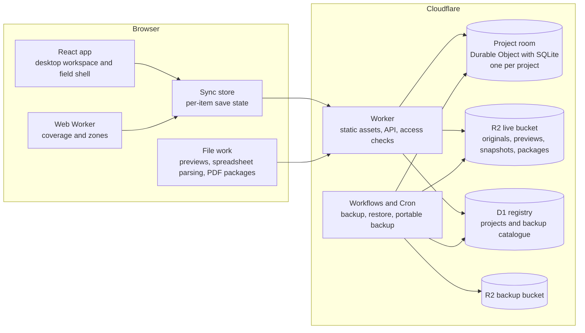

# Site Studio — Architecture

This document decides how the Site Studio proof of concept is built and hosted so that it meets the [PRD](../../prds/prd-PhySecDesign-2026-11-16/prd.md) and the [UX design specification](../../ux/ux-PhySecDesign-2026-11-18/ux-design-specification.md). It changes no requirement.

Kevin decided on 2026-11-18 that the application is hosted on Cloudflare. Everything else here is a proposal. The choices that are his to make are listed in [Decisions for Kevin](#12-decisions-for-kevin).

Three kinds of statement are kept apart:

- **Prototype today** — what the code in `site-studio/` does now.
- **Required** — what the PRD or UX specification asks for, cited by number.
- **Decided / Proposed** — what this architecture commits to.

Nothing here has been built or measured. Cloudflare limits quoted are from Cloudflare's documentation as read on 2026-11-18 and are collected, with sources, in [cloudflare-limits.md](cloudflare-limits.md).

## 1. Summary

Site Studio becomes one Cloudflare Worker that serves the existing React application and a small API.

- Each property project lives in its own **Durable Object**, a small single-threaded server with a private SQLite database. It is the one place where a project's records are read, checked and changed, which is what makes the PRD's conflict and consistency rules straightforward to enforce.
- Drawings, photos, fixed snapshots and PDF packages live in **R2** object storage, addressed by their content hash.
- A small **D1** database lists the projects and their backups.
- Coverage analysis, PDF and photo previews, spreadsheet parsing and PDF package generation stay **in the browser**, where the prototype already does them. The server stores and verifies their results.
- Browsers save with small, retry-safe operations and learn of other people's changes by **polling** every few seconds.
- A daily scheduled job copies every project to a **separate backup bucket**, and a restore job rebuilds a project in an isolated copy before any switch.

Expected running cost is the Workers Paid plan at 5 US dollars a month plus a few cents of storage. The Free plan is not enough: it allows 10 ms of processor time per request and 1 GB per Durable Object.

## 2. What drives the design

| Driver | Source | Consequence |
| --- | --- | --- |
| One shared, durable project; saves acknowledged within 2 s; others see them within 5 s | FR-2, FR-21, NFR-2, acceptance table | A server-side store per project with a change feed. |
| Per-item conflict detection, and connected changes validated together | FR-42 | Every editable item carries a version. Multi-item operations are checked and applied as one unit. |
| Retries never duplicate; evidence additions never conflict | FR-21, FR-31 | Every operation has a client-chosen identifier. Evidence is append-only. |
| Fixed issued designs, closeouts and exact package files | FR-26, FR-32, FR-34, NFR-1, NFR-6 | Immutable snapshots and files, addressed by content hash, never rewritten. |
| Access by revocable links, enforced on the server, for records and files | FR-2, FR-24, NFR-5 | Every request, including file downloads, passes through the Worker and is checked against a link. |
| Files up to 100 MiB, 8 GiB per project, 10 GiB portable backup | Acceptance table | Object storage with uploads in parts and streaming downloads. |
| Daily backups, seven generations, restore within 60 minutes into an isolated copy | FR-34 | A scheduled backup job, a separate bucket and a scripted restore. |
| Honest analysis within 10 s on the busiest plan, with stale results labelled | FR-13, NFR-4 | Analysis runs off the main thread, keyed to the inputs it used. |
| Phones do field work online | NFR-3, UX section 8 | A light field route that loads one floor and one device at a time. |
| One or two simultaneous users | Acceptance profile | No need for live cursors, merge algorithms or multi-region scaling. |

## 3. Starting point

**Prototype today.**

- React 19 and Vite 6, plain JavaScript, Leaflet for the map, pdf.js for PDF import. About 8,800 lines in `site-studio/src`.
- The project is one JSON document in the browser's IndexedDB, with portable export and import and migration from an older format.
- Coverage, DORI, zones, cables, capacity and materials are pure JavaScript modules with tests (137 test cases in `site-studio/tests`, using Node's test runner; not rerun for this document).
- PDF design packets are generated in the browser as raster pages.
- A review service runs only inside the Vite development server and stores JSON files on disk. It already uses revocable bearer links, hashed tokens, a version counter and serialised writes.
- The build is already packaged as a Cloudflare-style Worker that serves static assets, with a hosting file that names D1 and R2 as unused.

**What carries over.** The interface, the map engine, every calculation module, the PDF import and export code, and the link and version ideas from the review service.

**What is replaced.** IndexedDB as the place of record, the single-document project model, the dialogs that the UX specification turns into pages, and the development-only review service.

## 4. Architecture at a glance



## 5. Decisions

Each decision gives the choice, the reason and what was set aside. AD-1 is decided; the rest are proposed.

### AD-1 — Host on Cloudflare (decided)

One Worker serves the built React application as static assets and handles everything under `/api`. HTTPS comes with the platform. A `workers.dev` address is enough for the demo; a custom domain is optional.

The Workers Paid plan is required. Deployment uses Wrangler, with a local mode that runs the Worker, Durable Objects, D1 and R2 on the developer's machine.

### AD-2 — One Durable Object per property project holds its records

Each project gets one Durable Object, called the project room here, with its own SQLite database. All reads and writes of that project's records go through it.

Why this fits:

- A Durable Object handles one request at a time against its own storage, so "check the versions and the dependencies, then apply every change or none" (FR-42) is ordinary code in one place. No distributed locking is needed.
- It gives a natural home for the project's change sequence, which drives the change feed, action history, retry safety and guarded undo.
- Projects are isolated from one another by construction, which supports NFR-5.
- Storage is durable when a write is acknowledged, which is the PRD's meaning of Saved (NFR-2).
- The limit of 10 GB per object comfortably holds the records and history, estimated at about 300 MiB for the large fixture. Files are kept elsewhere.

Set aside: one shared D1 database for all projects. It would work, but D1 has no interactive transactions, so the validate-then-write logic would have to be expressed as conditional SQL batches, and all projects would share one 10 GB ceiling.

### AD-3 — Files live in R2, named by their content hash

Every stored file (original drawing, original photo, preview, spreadsheet source, snapshot, PDF volume, manifest) is an R2 object whose name includes its SHA-256 hash, under a prefix for its project.

- A file is never modified once stored. That is what makes issued designs, closeout records and packages fixed (FR-34).
- One source PDF used for several sheets is stored once (FR-6).
- Integrity can be checked at any time by re-hashing.
- The project room keeps the list of which records reference which files, and the running total against the 8 GiB budget.

A photo is reported as Saved only when both steps have succeeded: the object is complete in R2, and the project room has committed the entry that references it (FR-31).

### AD-4 — Large files upload in parts through the Worker

Cloudflare rejects request bodies over 100 MB on Free and Pro domains. The PRD allows a 100 MiB plan PDF, which is slightly larger, and a 10 GiB portable backup, which is far larger.

So every upload above a few megabytes is sent in parts of about 8 MiB. The Worker checks the link on each part and forwards it to an R2 multipart upload. This gives visible progress, retry of a single failed part, and no need to expose storage credentials to the browser. Downloads stream from R2 through the Worker with the same access check.

Set aside: presigned direct-to-R2 uploads. They avoid the Worker but need storage credentials, cross-origin rules and a second access model.

### AD-5 — Saves are small operations with an identifier; conflicts are detected per item

The browser sends an operation: a client-chosen identifier, the session identifier, the display name, and a list of changes, each naming the item and the version it was based on.

The project room then, as one unit:

1. Returns the stored result if it has already seen that operation identifier. A retry after a timeout therefore cannot duplicate anything (FR-21).
2. Checks that the project is not archived and that the link allows the change.
3. Checks each item's version. If any item changed since it was loaded, the whole operation is rejected with the latest saved values, who saved them and when. The browser keeps the pending edit and shows the comparison screen from the UX specification (FR-42).
4. Checks the domain rules that span items: the device state model, deletion eligibility, port claims, floor and building dependencies, scope and issued-design designation.
5. Applies all changes, increases each item's version, and appends one entry to the change log with before and after values.

Evidence (notes, photos, measurements, test attempts, comments, decisions, service visits, downtime entries) is append-only. Adding it carries an identifier but no base version, so two people adding to the same device both succeed (FR-31).

### AD-6 — Other people's changes arrive by polling

While the page is visible, the browser asks the project room every 3 seconds for changes after the last sequence number it has seen, and immediately when the tab regains focus. This meets the 5-second target with margin and is simple and dependable on mobile networks. The addendum already accepts polling as sufficient.

Incoming changes update the store's saved values. They never overwrite a field the user is editing or an item being dragged; the store holds them and the interface announces them, as the UX specification requires.

Set aside for now: a WebSocket from the project room. The project room can add it later without changing the data model.

### AD-7 — The change log is the history, the feed and the basis for undo

One append-only table in each project room records every accepted operation: sequence number, operation identifier, session, display name, time, kind, items touched, before and after values, and a reason where one was given.

It serves four requirements with one mechanism:

- The change feed for polling (AD-6).
- The traceable record of field changes and corrections (FR-27, FR-55).
- Retry safety (AD-5).
- Undo and redo. Undo is a new operation that restores the before values of one of this session's own operations. The project room accepts it only if the affected items and their dependents have not changed since; otherwise it explains what changed and asks for review (FR-21).

### AD-8 — Fixed records are immutable snapshots

A named revision, surveyed baseline, issued design or closeout record is created inside the project room: it reads the complete record set at one sequence number, writes it as one snapshot file to R2, and stores a row that points to the file. Because the room handles one request at a time, the snapshot cannot be a mixture of versions (FR-22, FR-32).

Snapshots reference photos and drawings by hash, so they cost little space. Restoring a revision reads the snapshot and applies design content only, as an ordinary guarded operation (FR-22). The current issued design is a pointer held as a versioned item, so two people cannot silently designate different revisions (FR-61).

### AD-9 — Analysis runs in the browser, off the main thread

The existing coverage, DORI and zone modules move unchanged into a Web Worker so the interface stays responsive (NFR-4). Each result carries a fingerprint of the inputs it was computed from. A result whose fingerprint no longer matches the current inputs is shown as Updating and is never presented as final (FR-13).

The last final summary for each floor and basis is saved to the project, with its fingerprint, so that the Overview, phones and packages can show it with an honest "as of" label without recomputing. A snapshot keeps the results it was taken with.

Set aside: computing on the server. Workers have a 128 MB memory ceiling and the calculation code is already browser JavaScript.

### AD-10 — File processing stays in the browser

- **PDF import.** The PDF is opened and its password used only in the browser, as today. The browser uploads the original file and a preview image of the chosen page. The password is never sent (FR-6).
- **Photos.** The browser makes a preview and uploads it with the original (FR-20).
- **Spreadsheets.** CSV and .xlsx files are parsed in the browser, reading values only and never running formulas or macros. The preview groups are computed there against the loaded records. Applying the import is one operation under AD-5, so the project room rechecks every version and rule (FR-58, FR-62). The source file is stored for provenance.

The Worker enforces the size limits, file types and the project budget regardless of what the browser claims.

### AD-11 — PDF packages are generated in the desktop browser and retained on the server

A package is generated from a fixed snapshot, never from live records. The browser renders the volumes with the existing exporter, extended for the new contents, and uploads each volume and the manifest. The project room registers the edition only when every listed file is present with the right hash. A failed or partial job is recorded as failed and can be retried; nothing partial is ever listed as complete (FR-33, FR-34, NFR-6).

This reuses working code and avoids running a headless browser on the server. Its cost is that a package cannot be produced from a phone and the tab must stay open while it runs. This is the largest unproven point in the design; see risk R1.

Set aside for now: rendering on the server with Cloudflare's browser service. It remains the fallback if R1 fails.

### AD-12 — Access is by link tokens, checked in the Worker

- A link carries a long random token. The browser keeps it out of server logs by sending it as a request header, as the prototype's review links already do. Only a hash of the token is stored.
- An edit link is scoped to one project. A reviewer link is scoped to one fixed revision and allows reading it, commenting and recording a decision (FR-24).
- Revoking or replacing a link takes effect on the next request. Earlier decisions stay on record.
- Display names are attribution only. A separate random session identifier, never the name, decides whose edits an undo may reverse.
- Creating a project, restoring a backup and reissuing a lost edit link need an administrator key that only Kevin holds, set as a Worker secret. Without it, anyone who found the address could create projects and consume storage.
- Link tokens, the administrator key and any passwords are excluded from snapshots, portable backups and restores (NFR-5).

### AD-13 — Backups go to a separate bucket every day; restore is scripted and isolated

A scheduled trigger starts one backup job per project each day. The job asks the project room for a complete export at one sequence number, copies any files not yet in the backup bucket, and writes a manifest listing every record file and file hash. The catalogue in D1 records the generation, its time, size and outcome. Seven successful daily generations are kept, plus one before any migration (FR-34). A file is deleted from the backup bucket only when no retained generation lists it.

Restore creates a new, separate project room and file prefix from a chosen generation, then checks counts, relationships, file hashes, snapshots, package files and the issued-design history. Only after those checks pass, and only on a deliberate administrator action, does the project's address switch to the restored copy. A failed restore leaves the working project untouched. Old links are not restored; new ones are issued.

Durable Objects also keep 30 days of point-in-time recovery. That is extra protection, not the mechanism the acceptance test relies on.

### AD-14 — The portable backup is a ZIP container built as a server job

A portable backup is a ZIP file, stored without compression, containing a manifest, the project's records and snapshots, and every referenced file under its hash. A job assembles it into R2 and the user downloads it afterwards, so creation time and transfer time are measured separately as the PRD requires. Importing one uploads it in parts (AD-4), then a job validates it and restores it into a new project.

The prototype's existing portable JSON files (versions 1 and 2) are imported in the browser through the existing migration code and then saved as a new project.

### AD-15 — Keep React, Vite and JavaScript; add a shared rules module

No framework change and no TypeScript migration. Three additions:

- **A shared module** of pure functions used by both the browser and the project room: record shapes and validation, the device state model, deletion and cancellation eligibility, port-claim rules and the retest trigger table. Sharing it means the browser can explain a rule before saving and the server enforces the same rule. It is tested with the existing Node test runner.
- **A sync store** in the browser that holds, per item, the saved value and version, any pending edit and its save state. This is what feeds the four save states and the conflict screen.
- **Routes and code splitting.** The eight areas, the field shell and the reviewer view become routes loaded on demand. This also addresses the prototype's bundle-size warning and keeps the phone download small.

## 6. Data model

### 6.1 Versioned items

Each has an identifier that never changes, a kind, a version number and its data. These are the conflict boundaries required by FR-42.

| Kind | Notes |
| --- | --- |
| Project settings, building, floor | The floor holds its drawing reference, alignment, analysis boundary and target height. |
| Device | Includes its camera views and configured streams, which are versioned with their parent. Holds lifecycle, placement, condition, provenance per field, and pan/tilt/zoom limits and positions (FR-63). |
| Camera-model template | Placed cameras copy the values they use, so later template edits do not change them (FR-47). |
| Door or gate, with component links | Links are part of the opening (FR-49). |
| Obstruction, zone, annotation | One item each. |
| Closet, port | A port is its own item so that two people cannot claim one port unnoticed (FR-51). |
| Cable run, riser | A run holds its ordered segments and length components (FR-52). |
| Work scope | Holds the per-device planned action, scope category and work-recorded marks for that scope, the estimate lines and the warranty (FR-45, FR-65). |
| Checklist definition, check | A check is one applicable check on one device or site, with its expected result and flags. |
| Issue | With its disposition per scope (FR-46). |
| Issued-design designation | One per scope (FR-61). |

Deleted drafts, cancelled and corrected records are kept as items with an end state and reason. They are filtered out of working content, not removed (FR-55).

### 6.2 Append-only entries

Notes, photo attachments, measurements, test attempts, reviewer comments and decisions, service visits, reliability runs and their downtime entries, and the change log. Each has an identifier, author name, session, time and the item it belongs to. A correction is a new entry that refers to the earlier one.

### 6.3 Fixed records

Named revisions, the surveyed baseline, issued designs, closeout records and package editions. Each is a row pointing to immutable files in R2.

### 6.4 Storage layout

Records are stored as JSON in a general items table, with indexed columns for the fields that are searched or filtered (kind, floor, identifiers, names, states). This keeps the browser and server models the same, makes snapshots a straightforward export, and eases migration from the prototype's JSON. Search over 600 devices is served from the loaded summaries in the browser, within the 1-second target.

## 7. Interface between browser and server

All paths are under `/api`. Every request carries the link token.

| Purpose | Request | Notes |
| --- | --- | --- |
| Open a project | Read project summary | Buildings, floors, device summaries, scope, issued reference, counts. |
| Open a floor | Read floor records | Devices, geometry, zones, annotations, routes for one floor. |
| Open a device | Read device detail | Checks, entries and history for one device, fetched when needed. |
| Save | Send operation | AD-5. Returns new versions, or the conflicts. |
| Add evidence | Send entry | Append-only. For a photo, sent after the upload completes. |
| Learn of changes | Read changes since a sequence number | AD-6. |
| Undo or redo | Send undo for an operation | AD-7. |
| Upload a file | Start, send parts, complete | AD-4. Completion returns the hash. |
| Download a file | Read by hash | Streams from R2 after the access check. |
| Fixed records | Create revision, issue, designate, close out, restore | Each is one guarded action in the project room. |
| Links | Create, replace, revoke | Edit-link holders manage reviewer links. |
| Jobs | Start and read status | Packages, portable backup, restore. |
| Administration | Create project, list backups, restore, switch | Administrator key. |

Errors use a small fixed set: not allowed, not found, conflict, rule violated (with the rule and the records involved), over limit, and try again. The browser turns each into the specific message the UX specification calls for.

## 8. How the main flows work

**Edit and save.** The user commits an edit. The store marks the item Unsaved, then Saving, and sends the operation. On success it stores the new version and shows Saved. On a network failure it keeps the edit, shows Unsaved, and retries with the same identifier after checking for changes.

**Two people, one camera.** The second save arrives with an old version. The project room rejects it and returns the saved values. The store marks the item Conflict and the interface shows the comparison. The user's choices are sent as a new operation based on the latest version.

**Photo on site.** The phone makes a preview, uploads the preview and the original in parts, then sends the entry. The photo shows Uploading until the entry is committed. If the upload fails, the entry is never created and the photo shows Failed with Retry.

**Record a removal.** One operation changes the device's lifecycle and sets a disposition on each affected cable end and port. The project room checks them together, so a stale tab cannot leave a port pointing at a removed device (FR-53).

**Issue a design.** The browser first resolves its own pending edits. The project room then writes the snapshot, creates the issued record, and, on the separate confirmation step, moves the designation pointer and marks the previous issue superseded.

**Close out.** The project room recomputes the remaining-work list at that moment, refuses Completed if anything is outstanding, writes the closeout snapshot, and sets the scope's state, all as one unit (FR-32).

**Import an inventory.** The browser parses the file, shows the mapping and the four row groups, and sends the confirmed rows as one operation with the versions it previewed against. Any row whose record changed in the meantime comes back as a conflict for review instead of being applied (FR-58).

## 9. How the quality requirements are met

| Requirement | Approach | Still to prove |
| --- | --- | --- |
| Save acknowledged within 2 s | One request to the project room and one local database write. | Measure on the reference connection. |
| Seen elsewhere within 5 s | 3-second polling. | Measure. |
| Open within 10 s, switch plan within 5 s | Load summaries first, then one floor; previews, not originals; routes loaded on demand. | Measure with the large fixture and a 100 MiB source PDF. |
| Analysis within 10 s at required fidelity | Web Worker, cancel and restart when inputs change, refine near targets. | Risk R2. |
| Find among 600 devices within 1 s | In-memory search over loaded summaries. | Measure on a phone. |
| Zero loss of acknowledged saves | Durable Object storage is durable on acknowledgement. | Restart test. |
| Recovery point within 24 h, restore within 60 min | AD-13. | Risk R3. |
| Access enforced on the server | AD-12; no file is served without a link check. | Tests for revoked and cross-project links. |
| Fixed records never change | Immutable, hash-named files; no update path exists for them. | Tests that later edits leave hashes unchanged. |
| File and project budgets | Enforced in the Worker and project room; usage shown before a limit is reached. | Boundary tests. |

## 10. Code structure

```
site-studio/
  src/            React application
    areas/        one folder per area of work, the field shell, the reviewer view
    sync/         sync store, operation queue, polling, upload in parts
    analysis/     Web Worker wrapper around the existing calculation modules
    ...           existing components and calculation modules
  shared/         record shapes, validation, state model and domain rules
  worker/
    index.js      routing, access checks, static assets
    project-room.js   the Durable Object
    files.js      upload, download, budgets
    jobs/         backup, restore, portable backup
    admin.js
  tests/          existing tests, plus shared-rule and project-room tests
  wrangler.jsonc  bindings for the Durable Object, R2 buckets, D1 and schedules
```

Rules for whoever implements this, so that separate pieces of work stay consistent:

- Identifiers are random and never reused or derived from names. Human-readable labels such as C-04 are data.
- Every write goes through an operation or an entry. No endpoint edits a record in place without a base version.
- A domain rule is written once, in `shared/`, and called from both sides.
- Times are stored as UTC timestamps and shown in local time. Lengths are stored in metres with their basis; money as integer minor units with a currency.
- Unknown is stored as an explicit value, never as a blank, zero or missing key.
- Nothing in R2 is overwritten. A changed file is a new object.
- Tokens and secrets never enter the items, entries, snapshots or logs.

## 11. Risks and early proofs

Each of these should be tested with a short experiment before the work that depends on it.

| # | Risk | Experiment | Fallback |
| --- | --- | --- | --- |
| R1 | Generating a complete package in the browser (up to 250 pages and 100 MiB per volume, 1 GiB per edition, within 5 minutes) may exhaust memory or time. | Generate a full-size edition from the large fixture on the reference laptop, one volume at a time. | Render on the server with Cloudflare's browser service, or lower raster resolution only if legibility holds and Kevin agrees. |
| R2 | The sampled solver may not finish 60 cameras with all zones in 10 s at 1 m spacing or finer. | Benchmark the existing modules in a Web Worker on the busiest plan. | Incremental recomputation of only the affected cameras; several workers; a spatial index for obstructions. |
| R3 | Copying up to 8 GiB between buckets and rebuilding a project may exceed 60 minutes. | Time a restore of a full-size generation. | Keep restore-ready copies; restore by reference to the backup bucket first and copy in the background. |
| R4 | Large photo uploads and previews on phones (25 MiB originals, limited memory, patchy signal). | Test on a real iPhone and Android phone over a throttled connection. | Smaller parts; resume after a dropped connection; warn before very large files. |
| R5 | Building and validating a 10 GiB ZIP inside Worker limits. | Build one from a full-size project; validate and restore it. | Split into numbered parts with a manifest. |
| R6 | Details not confirmed from documentation: the minimum part size for R2 multipart uploads, and whether Cloudflare's browser service prints PDFs. | Check both before AD-4 and the R1 fallback are relied on. | Adjust part size; choose another fallback. |

## 12. Decisions for Kevin

| # | Question | Recommendation |
| --- | --- | --- |
| K1 | Accept the Workers Paid plan, about 5 US dollars a month plus a few cents of storage? | Yes. The Free plan's limits are too low for this design. |
| K2 | One Durable Object per project as the place of record (AD-2)? | Yes. It makes the conflict and consistency rules simple to enforce. |
| K3 | Generate PDF packages in the desktop browser (AD-11)? Packages could then not be produced from a phone. | Yes, subject to experiment R1. |
| K4 | An administrator key, held by you, for creating projects, restoring backups and reissuing a lost edit link (AD-12)? | Yes. Otherwise the public address lets anyone create projects. |
| K5 | Backups in a second bucket in the same Cloudflare account (AD-13)? A second account would protect against losing the account itself. | Same account for the proof of concept, stated as a known limit. |
| K6 | Keep JavaScript, React and Vite, with no TypeScript migration (AD-15)? | Yes. |
| K7 | The prototype keeps a static "Sites" package (`.openai/hosting.json` and its test). Keep it working alongside the Cloudflare deployment, or retire it? | Keep it untouched for now; decide when the Cloudflare deployment is live. |
| K8 | Polling every 3 seconds for other people's changes (AD-6), with live push left for later? | Yes. |

## 13. Suggested build order

This is input to the epics stage, not a plan. It follows the delivery slices already kept as [input](../../prds/prd-PhySecDesign-2026-11-16/sources/delivery-slices-input.md).

1. **Foundation.** Wrangler configuration and local development; the project room with items, operations, the change log and polling; links; the sync store; the existing design tool saving to the server. Run experiments R2 and R4 here.
2. **Files and fixed records.** Uploads in parts, hash-named storage, snapshots, issuing, packages. Run R1 here.
3. **Field work.** Entries, checks, the field shell, conflict handling on phones, closeout.
4. **Existing sites and return visits.** Import, Awaiting placement, planned actions, scopes, issues, warranty and service visits.
5. **Extended modelling.** Multi-view and pan/tilt/zoom cameras, closets and ports, inter-floor runs.
6. **Recovery.** Daily backups, restore, portable backup. Run R3 and R5 here. This can start any time after step 2.

## 14. Not decided here

- The exact database tables, request formats and error codes, which belong to the first implementation stories.
- The workload manifest, reference hardware and benchmark procedure, owned by engineering and QA with Kevin.
- Monitoring and alerting beyond Cloudflare's built-in logs and a visible backup status.
- Anything for production use: individual accounts, tenancy, confidential client data, availability commitments.
