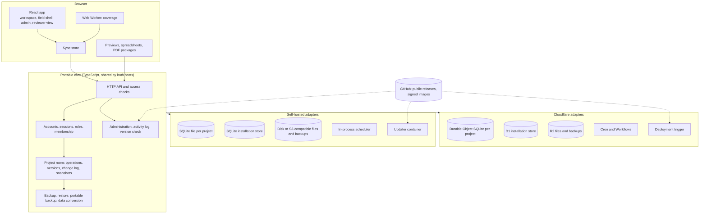

# Site Studio — Architecture

This document decides how Site Studio is built, hosted and updated so that it meets the [PRD](../../prds/prd-PhySecDesign-2026-11-16/prd.md) and the [UX design specification](../../ux/ux-PhySecDesign-2026-11-18/ux-design-specification.md). It changes no requirement.

**What changed from version 1.0.** Version 1.0 was written for one hosted demo on Cloudflare, opened by links. On 2026-11-18 Kevin decided that organisations can also host the software on their own servers, that people sign in with accounts, that releases are public and that an administrator can update from the interface ([amendment 1.2](../../prds/prd-PhySecDesign-2026-11-16/amendment-1.2-status.md)). Version 2.0 therefore makes the server portable between two hosts and adds accounts, administration, releases and updates. Version 1.0 is in the repository history.

Kevin confirmed every decision in this document on 2026-11-18, including the seven new ones listed in [Confirmed decisions](#13-confirmed-decisions). They stand subject to the early experiments in section 12; a failed experiment brings its decision back to him.

Nothing here has been built or measured. Cloudflare limits are from Cloudflare's documentation as read on 2026-11-18 and are collected in [cloudflare-limits.md](cloudflare-limits.md).

## 1. Summary

Site Studio is one application that an organisation runs in one of two ways, with the same features either way (NFR-7).

| | On Cloudflare | Self-hosted |
| --- | --- | --- |
| Runs as | A Cloudflare Worker | A Node.js server in a Docker container, on Linux |
| Project records | One Durable Object with SQLite per project | One SQLite file per project |
| Users, sessions, settings, activity log | A D1 database | One SQLite file |
| Files | An R2 bucket | A folder on disk, or any S3-compatible store |
| Scheduled and long jobs | Cron Triggers and Workflows | A scheduler inside the server |
| Updates | Starts the organisation's own deployment | An updater container installs the release |

The parts that decide behaviour are written once and shared by both: the rules for saving, conflicts, roles, snapshots, backups and data conversion. Each host supplies only thin adapters for storage, files, jobs and updates.

- People sign in with email and password. A session cookie identifies them; their role and project membership are checked on the server for every request, including every file.
- Clients can still review one fixed revision through a reviewer link, without an account.
- Browsers save with small, retry-safe operations and learn of other people's changes by polling.
- Coverage analysis, previews, spreadsheet parsing and PDF packages stay in the browser.
- Each release is published on GitHub, signed, with notes. An installation checks for a newer one and an administrator installs it with one action, after an automatic backup and with a return to the earlier version if anything fails.

## 2. What drives the design

| Driver | Source | Consequence |
| --- | --- | --- |
| Self-hosted or on Cloudflare, same product | FR-66, NFR-7 | A portable core with two sets of adapters, and one test suite run against both. |
| Accounts, roles and membership, enforced on the server | FR-67–69, NFR-5 | An installation-wide store for users and sessions; an access check in front of every project request and file. |
| Administrator controls and an activity log | FR-70, FR-71 | An administration interface over the installation store. |
| Update from the interface, safely | FR-72, NFR-8 | Signed public releases, ordered data conversions, backup first, health check, automatic return. |
| One shared durable project; saves within 2 s; others see them within 5 s | FR-2, FR-21, NFR-2 | A store per project with a change feed. |
| Per-item conflicts; connected changes validated together | FR-42 | Versioned items; multi-item operations applied as one unit by a single writer per project. |
| Fixed issued designs, closeouts and exact package files | FR-26, FR-32, FR-34, NFR-1, NFR-6 | Immutable snapshots and files named by content hash. |
| Files to 100 MiB, 8 GiB per project, 10 GiB portable backup | Acceptance table | Uploads in parts; streaming downloads. |
| Daily backups, seven generations, restore within 60 minutes | FR-34 | A scheduled job, separate backup storage, scripted isolated restore. |
| Honest analysis within 10 s | FR-13, NFR-4 | Analysis off the main thread, keyed to its inputs. |

## 3. Starting point

**Prototype today.** React 19 and Vite 6 in plain JavaScript, Leaflet, pdf.js; about 8,800 lines in `site-studio/src`; 137 test cases on Node's test runner (not rerun for this document). The project is one JSON document in the browser. A review service with revocable links exists only inside the development server. The build is already packaged as a Cloudflare-style Worker serving static assets. The repository carries an MIT licence.

**What carries over.** The interface, the map, every calculation module, PDF import and export, and the link and version ideas from the review service.

**What is replaced.** Browser storage as the place of record, the single-document model, the dialogs, and the development-only review service.

## 4. Architecture at a glance



## 5. Hosting and portability

### AD-1 — Two supported hosts: Cloudflare, and Linux with Docker (confirmed)

- **Cloudflare.** One Worker serves the built application and the API. The Workers Paid plan is required (confirmed, K1).
- **Self-hosted.** One Docker image runs a Node.js server that serves the same application and API. It is started with Docker Compose alongside an updater container (AD-21) and, optionally, a web server that provides HTTPS. A virtual machine and a physical server are the same case: a Linux machine with Docker. Supporting only this form keeps the number of combinations to test small.

Not supported at first: running without Docker, Windows Server as the host, and Kubernetes. A competent operator can do these, but they are not tested or documented.

### AD-16 — A portable core behind five small interfaces (confirmed)

All behaviour lives in the core, written in TypeScript against these interfaces. Each host implements them.

| Interface | Purpose | Cloudflare | Self-hosted |
| --- | --- | --- | --- |
| Project store | Open one project's database with single-writer access; run SQL in a transaction | Durable Object SQLite | A SQLite file with one writer at a time per project |
| Installation store | Users, sessions, memberships, settings, reviewer-link index, activity log, project and backup catalogue | D1 | A SQLite file |
| File store | Put in parts, get as a stream, check existence, list, delete; one live area and one backup area | Two R2 buckets | Two folders, or two S3-compatible buckets |
| Jobs and schedule | Run a long job in resumable steps; run something daily | Workflows and Cron Triggers | A job table and an in-process scheduler |
| Update | Report how updates are installed here; start one; report progress | Deployment trigger | Updater container |

Rules that keep it portable:

- The core uses only web-standard interfaces (Request, Response, streams, Web Crypto) and SQL that SQLite accepts. Both hosts provide these.
- One HTTP routing layer runs on both hosts.
- The same test suite runs against both sets of adapters in continuous integration. A feature is not done until it passes on both.
- The portable backup (AD-14) is the same format on both, which is what lets a project move between hosts (NFR-7).

Set aside: running Cloudflare's open-source runtime on the server so that only one set of adapters exists. It might remove the second adapter, but it has not been checked and Cloudflare does not present it as a hardened production server. See experiment R8.

## 6. Records, files and saving

These decisions are unchanged in substance from version 1.0 and were confirmed there. They are restated in host-neutral terms.

### AD-2 — One store per project, with a single writer (confirmed)

Each project has its own SQLite database, reached only through the project room, which handles one write at a time. That makes "check the versions and dependencies, then apply every change or none" (FR-42) ordinary code in one place. On Cloudflare the single writer is the Durable Object; self-hosted, it is a per-project queue in the server process.

### AD-3 — Files are named by their content hash and never overwritten (confirmed)

Originals, previews, spreadsheet sources, snapshots, PDF volumes and manifests are stored under their SHA-256 hash within the project's area. This makes fixed records fixed, stores a shared PDF once, and allows integrity checks. A photo is Saved only when the file is complete and the entry that references it is committed (FR-31).

### AD-4 — Large files upload in parts (confirmed)

Uploads above a few megabytes go in parts of about 8 MiB through the API, which checks access on each part. Cloudflare requires this because it limits a request body to 100 MB; using it on both hosts keeps one upload path with progress and per-part retry.

### AD-5 — Saves are small operations with an identifier; conflicts are per item (confirmed)

An operation carries a client-chosen identifier, the session, and changes that each name an item and the version they were based on. The project room returns the stored result for a repeated identifier, checks access and versions, checks the rules that span items, then applies everything and appends one change-log entry. Evidence is append-only and never conflicts.

Changed by amendment 1.2: the actor recorded is the signed-in account and its name at that time (FR-69), supplied by the access check and never by the browser.

### AD-6 — Polling for other people's changes (confirmed)

Every 3 seconds while the page is visible, and on regaining focus. Incoming changes never overwrite a field being edited. A live push channel can be added later on either host.

### AD-7 — The change log is history, feed and basis for undo (confirmed)

Undo is a new operation restoring the before-values of one of the same user's own operations in the same session, accepted only if nothing affected has changed since.

### AD-8 — Fixed records are immutable snapshots (confirmed)

Named revisions, the surveyed baseline, issued designs and closeout records are written from one consistent point and referenced by hash. The current issued design is a versioned pointer.

### AD-9 — Analysis runs in the browser, off the main thread (confirmed)

Results carry a fingerprint of their inputs; a mismatch shows Updating. The last final summary per floor is saved with its fingerprint.

### AD-10 — File processing stays in the browser (confirmed)

PDF opening and passwords, photo previews and spreadsheet parsing happen in the browser. The server enforces limits and types regardless.

### AD-11 — PDF packages are generated in the desktop browser and retained on the server (confirmed)

From a fixed snapshot, uploaded volume by volume, registered only when complete and verified. Subject to experiment R1.

## 7. Accounts and access

### AD-12 — Sessions for people who sign in; link tokens for reviewers (confirmed; replaces the link-only model)

**Signing in.**

- An account has an email address, a name, a password hash, an installation role and an active flag (FR-67, FR-68).
- Passwords are hashed with a memory-hard or iterated method chosen so that the same code runs on both hosts (experiment R9 chooses between Argon2id compiled to WebAssembly and PBKDF2 through Web Crypto). Hashes carry their parameters so they can be strengthened later.
- A successful sign-in creates a session: a long random token held in a cookie that scripts cannot read, sent only over HTTPS and only to this site. Only a hash of the token is stored. Sessions end after the idle period the administrator sets, on sign-out, on "sign out everywhere", on password change and on deactivation.
- Requests that change anything must come from the application's own origin and carry a header the application adds, which blocks forged cross-site requests.
- Failed sign-ins are slowed per account and per address, and the reply never reveals whether an email exists.
- Two-step verification uses time-based codes from an authenticator app, with single-use recovery codes stored as hashes.
- Invitations and password resets are single-use, expiring tokens. They are delivered by email when an email service is configured, and can always be copied by an administrator.

**Checking access.** Every request passes one gate in the core before it reaches a project room or a file:

1. Identify the caller: a session, a reviewer link token, or neither.
2. For a session: load the account, confirm it is active, and find its role and its membership of the project named in the request.
3. Decide: an administrator may do anything; an Editor may read and change their project; a Viewer may read and download; a reviewer link may read one fixed revision, comment and decide (FR-24).
4. Pass the decision and the actor to the project room. The project room trusts only this gate.

Membership is held in the installation store, so removing a member or deactivating an account takes effect on the next request (FR-68).

**Reviewer links** work as in version 1.0: a long random token sent as a header, stored as a hash, scoped to one fixed revision, revocable. An index of active links in the installation store lets an administrator list and revoke them (FR-70).

**First administrator.** An installation with no users accepts one set-up request that creates the first administrator, protected by a one-time set-up code printed in the server log or deployment output. This replaces version 1.0's permanent administrator key.

### AD-17 — The installation store (confirmed)

One small database per installation holds: users, password and recovery-code hashes, sessions, invitations and resets, project catalogue and memberships, the reviewer-link index, settings, the backup catalogue, the job table, and the activity log (FR-71). Secrets entered in settings, such as an email password or a map key, are encrypted with a key supplied to the installation at deployment and are shown only masked.

The activity log is append-only. Entries never contain a password, token or code.

### AD-18 — Email is optional (confirmed)

The core has an email interface with three implementations: none, SMTP (self-hosted), and an HTTP email service (either host). With none, every invitation and reset is a link the administrator copies. No feature requires email.

## 8. Backups and moving projects

### AD-13 — Daily backups to separate storage; scripted, isolated restore (confirmed, extended)

As in version 1.0: each day a job exports every project at one consistent point, copies files not already in the backup area, and writes a manifest; seven successful generations are kept plus one before any update or data conversion. Restore builds a separate copy, verifies it, and switches only on a deliberate administrator action.

Extended by amendment 1.2:

- The installation store is backed up in the same run, so accounts, memberships, settings and the activity log can be recovered (FR-34 as amended, FR-71).
- Recovering an installation ends every session and leaves revoked reviewer links revoked.
- Self-hosted, the backup area must be a different disk or a different machine from the live data to count as independent. The installer asks for it and the interface warns when it is the same disk.
- On Cloudflare the backup area is a second bucket in the same account (confirmed, K5).

### AD-14 — The portable backup is one ZIP format on both hosts (confirmed, extended)

It holds one project's records, snapshots, files and packages, a manifest, and the version of the data format. It holds no accounts, sessions or links. Import creates a new project in the receiving installation, where an administrator sets its members. An installation refuses a backup made by a newer version than itself.

## 9. Releases and updates

### AD-19 — One public repository; signed releases built by GitHub Actions (confirmed)

- The source stays in the public GitHub repository under its MIT licence.
- A version tag (for example `v1.3.0`) starts a workflow that runs the full test suite against both hosts, builds the Docker image for the common processor types, builds the Cloudflare deployment bundle, signs both, and publishes a GitHub Release with the release notes.
- The image is published to GitHub's container registry. Signing uses keyless signing tied to this repository's workflow, so an installation can verify that an image was built by this repository's release workflow and by nothing else.
- Version numbers follow the usual three-part scheme. Each release states the data-format version it needs.

### AD-20 — Data conversions are ordered, forward-only and run by the core (confirmed)

- Every project store and the installation store record their data-format version.
- The core carries every conversion step since the first release, so an installation can go from any earlier supported version to the latest in one update (FR-72).
- Conversions run per project, each inside a transaction, after the pre-update backup.
- The server refuses to start against data newer than itself (NFR-8).
- Going back means restoring the pre-update backup with the earlier version. No reverse conversions are written.

### AD-21 — How the Update control works on each host (confirmed)

**Checking for a version.** About once a day, and when an administrator asks, the server reads the public release list from GitHub. The request contains nothing about the installation. It can be turned off (FR-72).

**Self-hosted.** A separate updater container does the work, because the application cannot safely replace itself while running. It is the only part with permission to start and stop containers.

1. An administrator presses Update. The application asks the updater, over a private connection protected by a shared secret, to install a named version.
2. The updater accepts only versions from the configured repository and verifies the image signature.
3. The application takes the pre-update backup and tells signed-in users an update is starting. Their unsaved edits stay in their pages, as for any lost connection.
4. The updater stops the application, starts the new version, and the new version runs its data conversions.
5. The updater calls a health check. On success it reports the new version. On any failure it restores the pre-update backup, starts the earlier version, and reports what happened.
6. The outcome is written to the activity log.

The same steps can be run from a command line on the server, for an operator who prefers not to grant the updater its permissions.

**On Cloudflare.** A Worker cannot sensibly replace its own code, and storing a credential that can would be a standing risk. Each organisation therefore deploys from its own copy of the repository, using a deployment workflow that the repository provides.

- With one-step deployment set up, Update takes the backup and then starts that workflow for the chosen release; the new version runs its conversions on first start; the application reports the new version once it sees it.
- Without it, Update shows the exact steps to run the workflow by hand.
- Which trigger is best (starting a GitHub Actions run, or a Cloudflare build hook) is experiment R10.

## 10. Code structure

```
site-studio/
  src/              React application (JavaScript, existing)
    areas/          one folder per area, the field shell, the reviewer view
    admin/          sign-in, set-up, account, administrator screens
    sync/           sync store, operation queue, polling, upload in parts
    analysis/       Web Worker wrapper around the calculation modules
  shared/           record shapes, validation, state model, roles (TypeScript)
  core/             portable server (TypeScript)
    api/            routes and the access gate
    auth/           accounts, sessions, two-step verification, invitations
    project-room/   operations, change log, snapshots
    jobs/           backup, restore, portable backup, conversions
    admin/          administration, activity log, version check
    ports.ts        the five interfaces
  hosts/
    cloudflare/     Worker entry, Durable Object, D1, R2, Workflows adapters; wrangler.jsonc
    node/           server entry, SQLite, file and scheduler adapters; Dockerfile
  updater/          the updater container
  deploy/           docker-compose.yml, Cloudflare deployment workflow, install guides
  tests/            existing tests (Node's test runner)
  core-tests/       core tests, run against both hosts
.github/workflows/  test, release
```

Rules for implementers, in addition to those in version 1.0 (random identifiers; every write through an operation or entry; each rule written once in `shared/`; UTC times; explicit Unknown; nothing overwritten in file storage; no secrets in records or logs):

- Nothing under `core/` imports from `hosts/`. Host code is reached only through `ports.ts`.
- The actor of any action comes from the access gate, never from the request body.
- Every new table or record shape comes with its conversion step and a test that converts data from the previous release.
- A route that is not explicitly marked as public, reviewer-link or signed-in is refused.

Language and tests are as confirmed (K6): existing application code stays in JavaScript; `shared/`, `core/`, `hosts/` and `updater/` are TypeScript; core tests use Vitest, run in Cloudflare's runtime for that host and in Node for the other.

## 11. How the quality requirements are met

| Requirement | Approach | Still to prove |
| --- | --- | --- |
| Save within 2 s; seen elsewhere within 5 s | One request to the project room; 3-second polling. | Measure on both hosts. |
| Open within 10 s; switch plan within 5 s | Summaries first, then one floor; previews; routes loaded on demand. | Measure with the large fixture. |
| Analysis within 10 s | Web Worker; cancel and restart; refine near targets. | R2. |
| Zero loss of acknowledged saves | Durable storage on acknowledgement; self-hosted, SQLite with synchronous writes on a persistent volume. | Restart and power-loss tests on both hosts. |
| Recovery point 24 h; restore within 60 min | AD-13. | R3, on both hosts. |
| Access enforced on the server | The access gate (AD-12); no file without a check. | Tests for non-members, Viewers, deactivated accounts, ended sessions, revoked and out-of-scope links. |
| Same product on either host | AD-16; one test suite on both. | SM-6. |
| Safe updates | AD-20, AD-21. | R11. |
| Fixed records never change | Hash-named files; no update path. | Hash tests after later edits. |

## 12. Risks and early proofs

| # | Risk | Experiment | Fallback |
| --- | --- | --- | --- |
| R1 | Generating a full-size package in the browser within 5 minutes. | Generate a full edition from the large fixture, one volume at a time. | Server-side rendering; it would need an answer for both hosts. |
| R2 | 60 cameras and all zones in 10 s at 1 m spacing or finer. | Benchmark the existing modules in a Web Worker. | Incremental recomputation; several workers; a spatial index. |
| R3 | Restoring 8 GiB within 60 minutes. | Time a full-size restore on each host. | Restore by reference first, copy in the background. |
| R4 | Large photo uploads on phones over poor connections. | Test on a real iPhone and Android phone, throttled. | Smaller parts; resume; warn before very large files. |
| R5 | Building and validating a 10 GiB ZIP within Worker limits. | Build, validate and restore one on each host. | Numbered parts with a manifest. |
| R6 | Unconfirmed: the minimum part size for R2 multipart uploads; whether Cloudflare's browser service prints PDFs. | Check both. | Adjust part size; choose another fallback for R1. |
| R7 | Cloudflare's Vite plugin and Vitest integration with Vite 6.4 and React 19. | First task of the foundation work. | Run the Worker with Wrangler beside the Vite server. |
| R8 | The second set of adapters doubles storage-layer testing. Cloudflare's open-source runtime might run the Cloudflare build on a server instead. | Read its documentation and try a Durable Object with persistent storage on a server. | Keep two adapters as designed. |
| R9 | Password hashing must be strong and must fit the Worker's processor allowance. | Time Argon2id in WebAssembly and PBKDF2 in Web Crypto on both hosts. | Use whichever meets current guidance within the allowance. |
| R10 | The best trigger for a Cloudflare deployment from the interface is unverified. | Compare starting a GitHub Actions run with a Cloudflare build hook, for what each needs stored. | Show manual steps only. |
| R11 | An update that fails half-way must return cleanly. | Break an update at each step on a test server and confirm the earlier version and data return. | Block the release of the Update control until it does. |
| R12 | SQLite files on network or slow disks can lose durability or lock. | Test on a typical virtual machine disk; document unsupported storage. | Require local disk for records; allow object storage for files only. |

## 13. Confirmed decisions

Confirmed in version 1.0 and unchanged: K1 Workers Paid plan; K2 one store per project; K3 packages generated in the desktop browser; K5 Cloudflare backups in the same account; K6 TypeScript for new server and shared code with Vitest; K7 keep the static Sites package for now; K8 polling.

Replaced: K4, the permanent administrator key, gives way to administrator accounts and a one-time set-up code (AD-12).

New in version 2.0, confirmed by Kevin on 2026-11-18 as recommended:

| # | Question | Confirmed |
| --- | --- | --- |
| K9 | Support self-hosting only as Docker on Linux at first (AD-1)? | Yes. A virtual machine and a physical server are then the same case. |
| K10 | Build the Cloudflare host first and the self-hosted host second, with the core portable from the first day (AD-16)? | Yes. The first demo is on Cloudflare, and the core tests run on both from the start so portability does not decay. |
| K11 | Give the updater container permission to start and stop containers, so the button works, with a command-line alternative (AD-21)? | Yes. It is the standard way and the permission is confined to one small container. |
| K12 | On Cloudflare, have Update start the organisation's own deployment workflow, with manual steps as the fallback (AD-21)? | Yes, subject to experiment R10. |
| K13 | Email optional, with copyable invitation and reset links (AD-18)? | Yes. It removes a set-up obstacle for small organisations. |
| K14 | Publish images to GitHub's container registry and sign them with keyless signing (AD-19)? | Yes. No signing key for you to guard. |
| K15 | Make the repository public now, or when the first release is ready? This is a setting only you can change on GitHub. | When the first release is ready, after a check that nothing private is in the history. |

## 14. Suggested build order

Input to the epics stage, which needs a further pass after amendment 1.2.

1. **Foundation.** Repository layout, the five interfaces, the Cloudflare adapters, local development (R7); the project room with operations, change log and polling; the sync store; the existing design tool saving to the server. Core tests run on both hosts from here, using a minimal Node adapter. Run R2, R8 and R9.
2. **Accounts and access.** Set-up, sign-in, sessions, roles, membership, the access gate, reviewer links, the activity log, the first administrator screens.
3. **Files and fixed records.** Uploads in parts, snapshots, issuing, packages. Run R1 and R6.
4. **Field work**, then **existing sites and return visits**, then **extended modelling**, as in the earlier build order.
5. **Recovery.** Backups of projects and the installation store, restore, portable backup. Run R3 and R5.
6. **Self-hosting.** Complete the Node adapters, the Docker image, Compose file and install guide. Run R12.
7. **Releases and updates.** Release workflow, signing, version check, data conversions, the updater, the Cloudflare deployment workflow. Run R10 and R11. Then the cross-host acceptance of SM-6.

## 15. Not decided here

- Exact tables, request formats and error codes.
- Password length, lock-out thresholds and default session length. These follow current published guidance at implementation time and are recorded then.
- Single sign-on, which the PRD leaves for later. The access gate is the one place it would attach.
- Monitoring beyond built-in logs, the activity log and visible backup and update status.
- Support arrangements, security disclosure process and release cadence for organisations that host the software.
